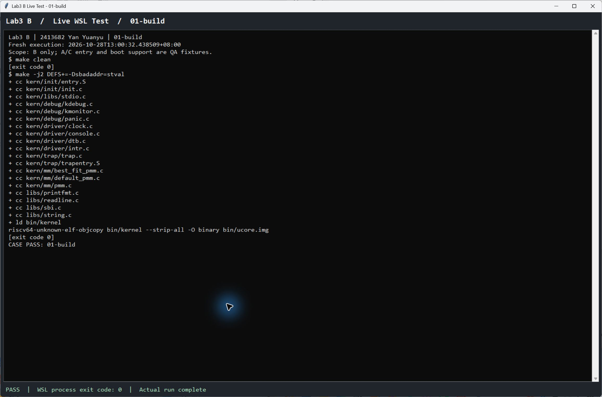
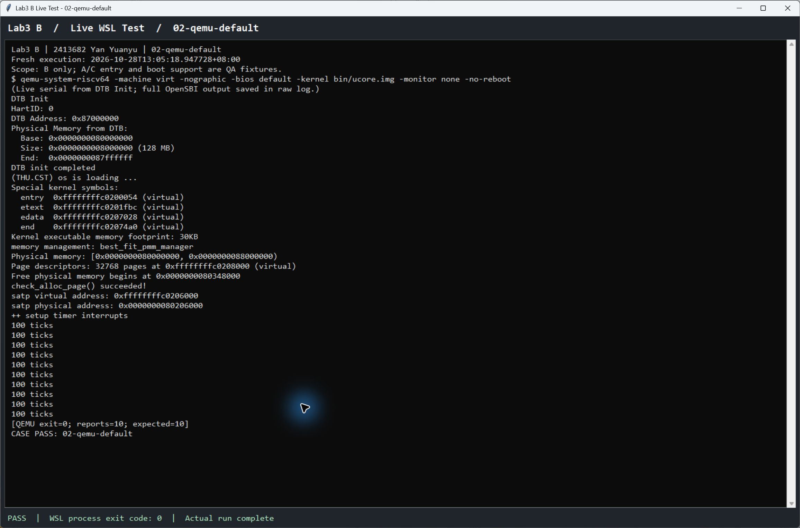
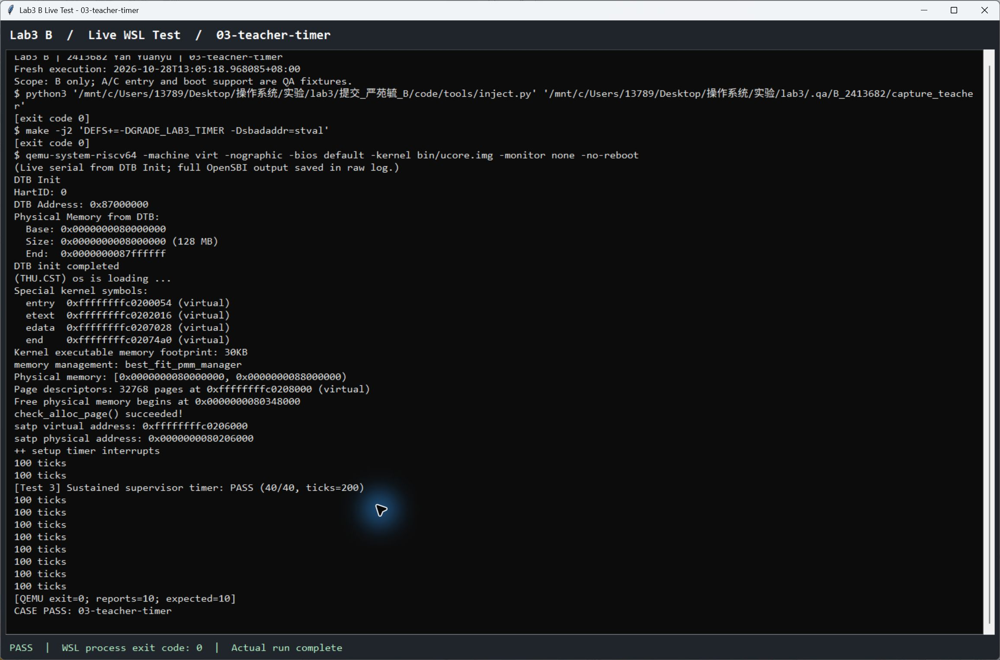
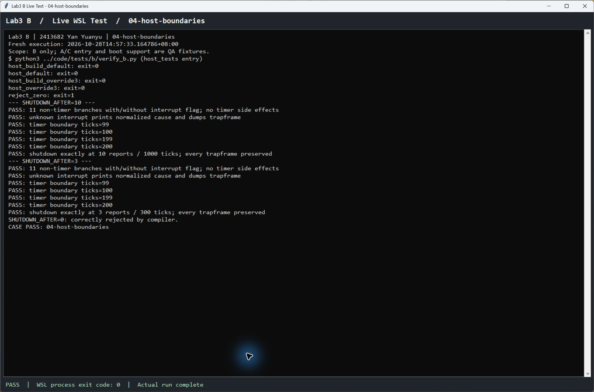
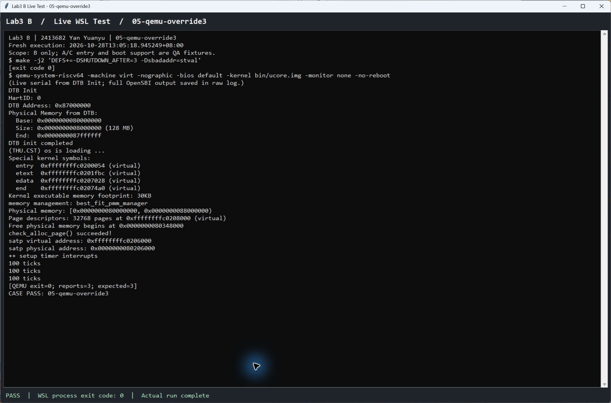
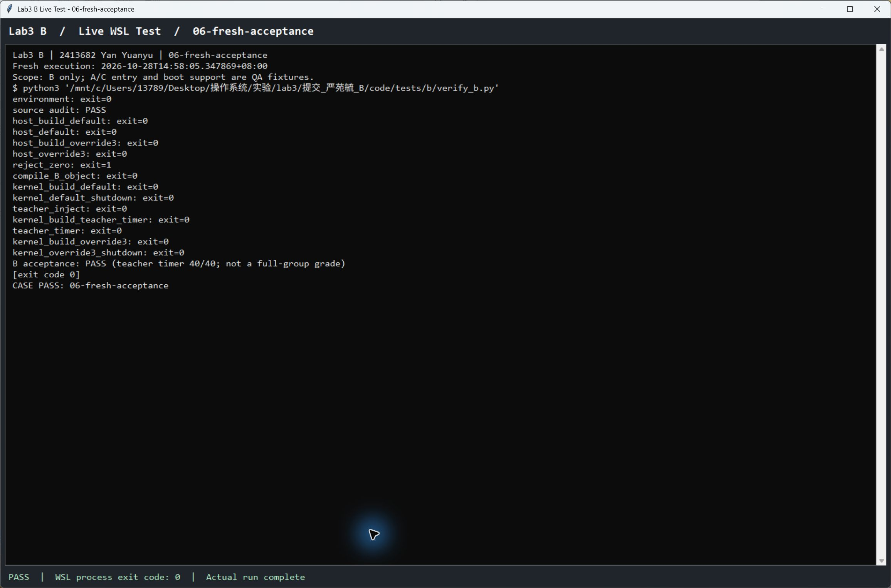

# 操作系统实验报告

## 实验基本信息

| 项目 | 内容 |
|---|---|
| **实验名称** | Lab3 中断与异常处理 B 部分 |
| **小组成员** | 2413681 王优、2413682 严苑毓、2413636 杨思远 |
| **当前 B 模块负责人** | 2413636 杨思远 |
| **完成及复测日期** | 2026-10-28 |

### 小组分工

| 模块 | 负责成员 | 负责内容 |
|---|---|---|
| A 上下文与入口 | 严苑毓 2413682 | RESTORE_ALL、__alltraps、上下文恢复与 Trap 返回 |
| B 中断处理 | 杨思远 2413636 | interrupt_handler、中断分类、持续时钟、计数、统计输出和关机 |
| C 异常处理 | 王优 2413681 | exception_handler、非法指令与断点、指令长度和 EPC 推进 |

本次按用户确认的最终分工更新责任人。来源说明：原 B 交付包及其历史报告署名为严苑毓 2413682，原始截图、日志与测试过程保留该来源，不将历史操作重新归属给杨思远。本报告完整记录 B 部分；A/C 的代码、测试及报告由对应成员提供。

### 实验报告分工

每人提交本人模块的功能理解、spec、prompt、实际问题与测试证据。严苑毓负责本报告的 B 内容和对应六张测试截图；三人共同完成整体执行流、原理联系和集成验证，再汇总为小组报告。

---

## 一、实验目的

实现统一 Trap 入口之后的异步中断分类和处理，使内核能够持续响应 S 态时钟中断、记录次数、输出统计并按约定关机。通过模块测试和实际 QEMU 运行，理解时钟硬件接口、软件计数及上下文返回之间的关系。

## 二、实验环境

本轮实际环境为 Windows 上的 WSL Ubuntu-22.04，内核 `6.6.87.2-microsoft-standard-WSL2`。交叉编译器 `riscv64-unknown-elf-gcc 15.1.0`，QEMU `7.0.0`，宿主 GCC `11.4.0`，Python `3.10.12`。完整版本输出见 logs/environment.log。

### AI 编程工具

| 成员 | AI 编程工具 | 底层模型 | 备注 |
|---|---|---|---|
| 严苑毓 2413682 | Codex 桌面端 | GPT-6.1 Sol | 当前对话界面显示；本报告只记录 B 的开发 |

### 系统与工具

环境版本均来自本轮实际命令输出，见 [environment.log](logs/environment.log)。

源码底版来自老师 lab3.zip 解压后的 lab3_new。实验二依赖来自 `lab2/提交_小组_Lab2/code`，不是个人阶段提交。只迁入 page_init 和 Best-Fit，保留 Lab3 在内存分配/释放/计数查询周围的本地中断保护。老师本次 basic_check 和 best_fit_check 函数正文逐字保持。

## 三、实验整体逻辑分析

### 3.1 本章节的逻辑主线

初始化时，idt_init 将 stvec 设置为 __alltraps。clock_init 开启 S 态定时器中断来源，安排第一个时钟事件并清零 ticks；intr_enable 打开全局 SIE。事件到来后，由 A 的汇编入口保存上下文，将 Trap frame 传给 trap。trap_dispatch 根据 cause 的最高位选择 interrupt_handler 或 C 的 exception_handler。

B 的处理完成后直接返回，不改动 Trap frame 的 EPC 和其他现场。随后统一经过 A 的恢复流程和 sret 返回。这里的时钟中断打断的是内核执行，恢复目标仍应是原执行现场，不能把“sret”理解成必然返回用户态。

### 3.2 功能的逐步实现

完整主线为：初始化定时器和入口 → 事件触发 → 保存现场 → 分类处理中断 → 安排下次事件 → 恢复现场并返回。B 负责其中的分类、时钟续设、计数、统计输出和关机。

## 四、实验内容与实现

### 功能模块 B 中断处理

**负责人：** 严苑毓 2413682。

#### 模块功能描述

**需要实现的函数：**

接口保持为：

```c
void interrupt_handler(struct trapframe *tf);
```

四段式规格与完整复现提示词见 [prompt.md](prompt.md)。规格在本轮实现中明确了依赖、职责边界、可观察结果及验收标准，没有把未发生的模型调用或 bug 写成历史过程。

#### 中断分类

tf->cause 的最高位用于标记异步中断，其余位表示原因。B 仅在局部变量中屏蔽最高位，不修改 tf->cause，再按老师 riscv.h 提供的 IRQ 宏分支。U/S/H/M 软件中断、非 S 定时器中断以及外部中断输出各自类型提示；H 沿用框架命名，不能据此认定本实验已支持对应硬件扩展。

已知非时钟分支只提供本次实验要求的诊断，不负责清除真实设备的中断源。未知编号输出 `Unknown interrupt: cause <编号>`，并调用已有 print_trapframe(tf)，避免静默丢失诊断信息。

#### 持续时钟与统计

IRQ_S_TIMER 分支调用 clock_set_next_event，保证 SBI 当前一次性事件之后仍有下一次事件。每收到一次中断，ticks 恰增加一次；新值是 TICK_NUM 的整数倍时调用老师的 print_ticks。

TICK_NUM 为 100，因此控制台每行都是 `100 ticks`，表示这一个统计周期包含 100 次中断，不是累计显示 `100、200、300 ticks`。累计次数保存在 ticks 中，打印次数由函数内部 static size_t reports 记录。两个计数意义不同。

该分支不调整 tf->epc；异步时钟事件没有要求跳过一条故障指令。非法指令和断点的 EPC 推进属于 C 的任务。

#### 关机配置

手册要求达到 SHUTDOWN_AFTER 次输出后调用已有的 sbi_shutdown，但未提供数值，老师代码也未定义。本交付用 `#ifndef` 提供默认 10，含义为打印 10 次，即 1000 次中断。可以通过编译宏覆盖；0 或负数由预处理检查拒绝。

默认值是本次实现选择，不是老师明确要求。测试了默认 10 和覆盖为 3 两种配置；组内统一新值后应按新配置重新验证。

#### 最终提示词

本轮实现与验收所采用的四段式规格如下；独立汇总文件见 [prompt.md](prompt.md)。

````markdown
## [PROMPT]

在老师 Lab3 框架 kern/trap/trap.c 中实现 B 的中断处理模块 interrupt_handler(struct trapframe *tf)，保留函数签名，保留已有函数和数据结构。按现有 IRQ 宏分类；让 S 态时钟中断能够持续触发、准确计数、按周期打印并在达到约定次数后关机。其他已定义的软件、定时器和外部中断给出相应类型提示，未知类型打印原因与完整 Trap frame。不得实现 C 的 exception_handler，也不得在正式交付中填写 A 的汇编空位。

## [RELY]

- tf 非空，指向有效 Trap frame；tf->cause 的最高位是中断标志，其余位是原因编号。框架 trap_dispatch 已按最高位分流。
- clock.h 提供 volatile size_t ticks 与 clock_set_next_event()；clock_init 已安排首个事件并将 ticks 清零。
- trap.c 已提供 TICK_NUM=100 与 print_ticks()，后者正常构建时打印一行 `100 ticks`。
- sbi.h 提供 sbi_shutdown()；print_trapframe(tf) 提供诊断输出；IRQ 宏以当前 riscv.h 为准。
- 同一 hart 上中断处理期间不主动重新开启 SIE，不要求多核同步；ticks 在一次内核运行中不被外部重置。
- 手册提及 SHUTDOWN_AFTER，但没有给出数值，框架也未定义。本交付采用可编译覆盖的默认值 10，含义是“打印次数”，不是“中断次数”。这是本次实现约定，组内或教师明确新值后可调整。
- A 负责保存与恢复寄存器、向 trap() 传参和 sret；C 负责异常及 EPC 更新；B 不改变这些模块。

## [GUARANTEE]

- 提供非 static 的 void interrupt_handler(struct trapframe *tf)，可供统一分发和老师测试调用。
- 保留 Trap frame 的所有字段；尤其不修改 epc、status、cause 和通用寄存器快照。
- 每次 S 态时钟中断均安排后续事件，并且 ticks 恰增加一次；其他中断不更新 ticks，也不安排时钟事件。
- 不修改 print_ticks、trap_dispatch、trap、idt_init、SAVE_ALL 或老师的测试文件。
- 正式 code/ 保留 A、C 空位；仅增加 C 的前置声明以保证 B 的编译单元能独立编译。临时测试支持代码必须独立标注并与小组正式实现区分。

## [SPECIFICATION]

前置条件：满足 RELY，调用方已经保存上下文，当前不嵌套执行本处理函数。

1. S 态时钟中断：本次计数增加一次，后续定时器已安排；当新 ticks 是 100 的整数倍时恰打印一行统计；累计打印达到 SHUTDOWN_AFTER 时调用已有关机接口。默认情况下，前 999 次中断不关机，第 1000 次打印第 10 行并关机。
2. 其他已定义中断：按当前框架中 U/S/H/M 软件中断、非 S 定时器中断和 U/S/H/M 外部中断分类打印。H 宏是老师头文件中的命名，不代表本实验验证了 Hypervisor 硬件支持。
3. 未知中断：输出 `Unknown interrupt: cause <去掉标志后的编号>` 并调用 print_trapframe(tf)；与其他非时钟分支一样，不修改执行现场。
4. 配置：SHUTDOWN_AFTER 缺省为 10；允许用编译宏覆盖，非正值在编译时拒绝。TICK_NUM 保持老师定义。
5. 验证：宿主测试调用实际 B 函数覆盖分类、99/100/199/200 次边界、默认与覆盖后的关机边界、Trap frame 不变；临时测试支持环境中交叉编译并在 QEMU 运行，检查重复时钟返回、老师原始时钟测试和实际关机退出。

验收不以修改老师评分条件换取通过。A、C 的临时支持实现不作为组员交付，不声明全组最终 100 分。
````

#### 实现迭代过程

本模块先完成一次 B 实现，再根据实际测试修正测试脚本与公共兼容问题。以下按真实发生的过程记录，不把测试工具问题写成 B 算法错误。

1. 完成 B 实现及实验二必要依赖迁移，保留 A/C 空位；B 的实际处理函数在本轮宿主和 QEMU 测试中没有发现行为错误。
2. 第一次宿主测试生成器错误处理了 C 字符串转义，生成源码含字面 NUL，GCC 以 `null character(s) preserved in literal` 拒绝。将输出缓冲区清零写成数值 0 后通过。这是测试脚本错误，不是内核 B 代码错误；保留原日志 iteration1_host_harness_error.log。
3. 临时内核首次构建遇到老师汇编中的 `unknown CSR sbadaddr`。本机工具链使用 stval 名称，通过测试编译宏映射旧名解决；不改正式 SAVE_ALL。原日志见 iteration2_old_csr_error.log。
4. 最初测试命令使用高地址 ELF 启动超时，随后改用实验二已采用的原始镜像启动方式。原始 Lab3 启动页表在切换 Sv39 后也没有物理 PC 的过渡映射；短时探测只有 OpenSBI 输出，没有内核输出，见 iteration3_boot_probe.log。测试副本加入实验二最终版的恒等过渡映射后正常启动。此修正属于公共启动依赖，不计作 B 新增逻辑。
5. 在隔离支持环境中依次通过默认关机、老师原始 TIMER 场景和自定义关机配置。未为了得到完整分数而填写 C 的异常实现。
6. 打包检查时发现 Windows 生成的补丁使用 CRLF，而老师源码为 LF，导致普通 git apply 检查失败。仅将补丁行尾统一为 LF 后，三份补丁的普通 `git apply --check` 均通过；内核源码和已验收行为没有变化。

## 五、测试与验证

复现命令：在 WSL 中进入本交付目录，执行 `python3 ../code/tests/b/verify_b.py`。它读取正式 B 函数进行宿主检查，编译实际 trap.c，然后在临时副本中准备测试所需的入口与启动支持。测试结果、命令、退出码和运行用时见 [logs/summary.json](logs/summary.json)。

| 验证项目 | 本轮结果 | 原始证据 |
|---|---|---|
| 11 个非时钟分支，有/无最高位标志 | 提示匹配，ticks 和定时器无变化 | host_default.log |
| 未知编号 15，有/无最高位标志 | 输出归一化原因，调用现场打印 | host_default.log |
| 99/100/199/200 次边界 | 每次加一，恰按 100 次打印 | host_default.log |
| 默认 1000 次关机边界 | 此前不关机，第 1000 次调用一次 | host_default.log |
| 覆盖为 3 次输出 | 第 300 次调用关机 | host_override3.log |
| SHUTDOWN_AFTER=0 | 编译按预期拒绝，退出码 1 | reject_zero.log |
| 正式 B 文件交叉编译 | 退出码 0 | compile_B_object.log |
| QEMU 默认运行 | 恰 10 行统计，正常退出 0 | kernel_default_shutdown.log |
| 老师原始 TIMER 场景 | PASS (40/40, ticks=200)，之后持续到关机 | teacher_timer.log |
| QEMU 覆盖为 3 | 恰 3 行统计，正常退出 0 | kernel_override3_shutdown.log |
| 正式源码范围与老师检查 | 仅 3 文件改变，A 原样，老师检查原样 | summary.json、source_hashes.json |

宿主测试检查了整个 Trap frame 在 B 处理前后字节不变；时钟续设接口替换为可计数桩，关机也用桩捕获边界，因此这部分证明的是处理函数语义。真实硬件接口、重复 Trap 返回和关机退出另外由 QEMU 实测支撑。

QEMU 使用 128 MiB 默认内存、单 hart、OpenSBI 和 `-kernel bin/ucore.img`。临时 A 支持完成寄存器恢复和调用，临时 C 支持遇异常即 panic；它们不会进入正式 code/，也不等于组员正式交付。老师原 TIMER 测试函数及注入器未修改；没有直接运行完整 grade.sh，也没有验证 A/C 的评分场景。

### 5.1 本轮复测与截图说明

本轮在 2026-10-28 重新执行了编译、QEMU、老师时钟测试、宿主边界测试与完整 B 验收。截图由原生窗口截图工具直接采集本地 Live WSL Test 窗口；窗口启动新的 WSL 子进程并显示其输出，不读取历史日志回放，也不生成终端图片。QEMU 窗口从 DTB Init 起显示实时串口，完整 OpenSBI 输出保存在原始日志中。所有截图逐张检查过，可见命令、结果和进程退出状态。

本轮窗口执行记录、命令和时间在 [logs/screenshots/](logs/screenshots/)；图片来源与哈希见 [截图说明.md](截图说明.md)。

### 5.2 编译成功

临时测试副本接通 A 的入口和恢复路径，C 使用遇异常即终止的占位函数，并应用公共启动兼容措施。图中可见编译、链接和镜像生成均以退出码 0 结束。



### 5.3 默认配置下持续中断和关机

QEMU 实际启动后完成物理内存自检，连续打印十行 `100 ticks`，随后由内核运行中的 sbi_shutdown 关机，QEMU 正常退出。测试脚本校验了行数为 10 和进程退出码为 0。



### 5.4 老师原始时钟测试结果

原始注入器和 TIMER 测试函数未改动。图中显示 `[Test 3] Sustained supervisor timer: PASS (40/40, ticks=200)`；通过该标记后仍继续处理中断，直至默认关机。



这是一张 B 时钟测试结果图，不是全组 make grade 结果。当前 A/C 正式实现尚未合入，完整 make grade 的唯一结果截图应由三人集成后补入小组总报告；本 B 报告不以支持代码的运行结果代替 A/C 验收。

### 5.5 分类与计数边界

宿主测试直接提取正式 interrupt_handler 和配置进行编译，覆盖非时钟分类、未知中断、现场保持、99/100/199/200 次边界、默认和覆盖后的关机边界，以及非法配置拒绝。图中 `reject_zero: exit=1` 是预期拒绝，不是验收失败。



### 5.6 自定义关机次数

构建时覆盖 SHUTDOWN_AFTER=3，QEMU 恰打印三行后正常退出；表明实现使用的是约定的统计输出次数，而非写死默认的 1000 次中断。



### 5.7 整理后的交付再次验收

对当前 code/ 重新执行源码范围检查、宿主测试、B 源文件交叉编译和三个 QEMU 场景，最终输出 `B acceptance: PASS`。完整命令和退出码见本轮 [summary.json](logs/summary.json)。



## 六、实验总结与收获

### 对操作系统的理解

Trap 是 RISC-V 中中断与异常的总称。时钟中断是异步事件，异常由正在执行的指令触发；两者共用入口和现场结构，但处理原因与返回位置策略不同。stvec 管入口，scause 说明原因，sepc 和 sstatus 参与恢复执行位置和权限；B 使用保存后的 cause 进行分类，不负责恢复 CSR。

时钟事件是时间片调度的重要基础，但本实验 B 只实现时钟响应与计数，并未实现进程调度、抢占策略、阻塞唤醒或多核时钟同步。打印次数、累计 ticks 与真实时间也不能混为一谈；实际经过时间会受模拟器运行和处理开销影响。

当前单 hart 的处理中不主动开启 SIE，避免本处理过程被同级中断嵌套；不能将此推广为所有操作系统都不允许内核中断或缺页。实验二内存接口在 Lab3 增加的中断保护也必须保留。

### AI 协作开发的经验

AI 协作中，职责边界和验收条件比只说“补 interrupt_handler”更有用。测试发现的环境与启动问题应按真实归属记录，不能为了报告显得有迭代而编造 B 的算法 bug。原始输出、失败日志与源文件哈希共同明确了结果适用的版本和运行条件。
