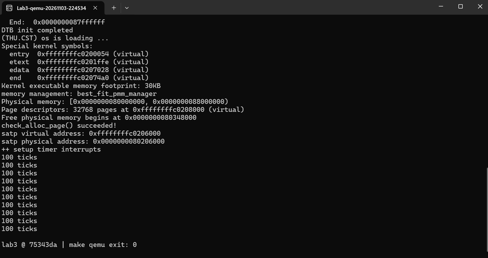
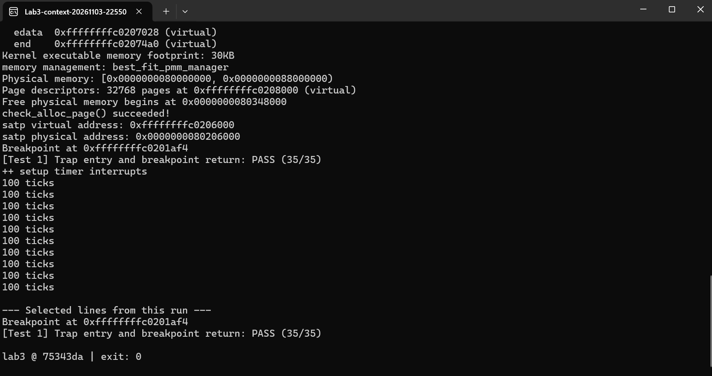
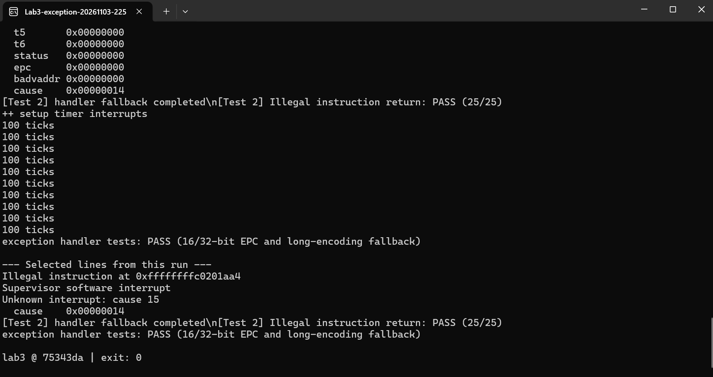
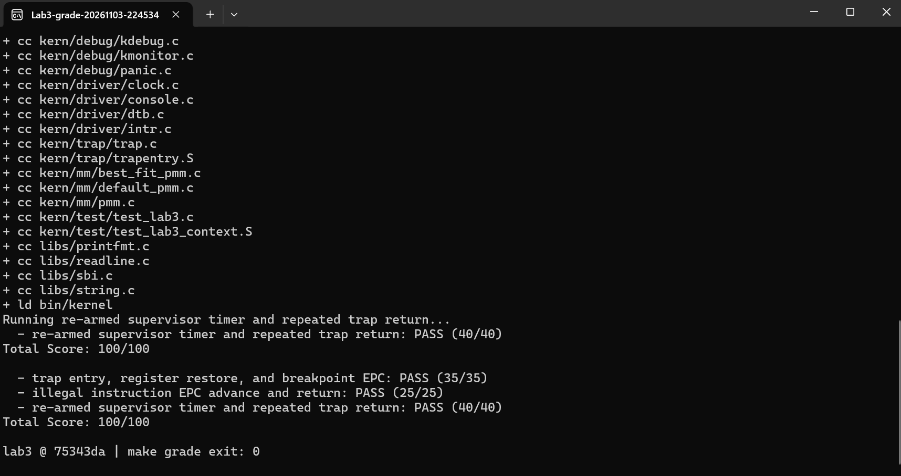

# 操作系统实验报告：Lab3 中断与异常处理

## 小组分工

| 成员 | 负责模块 | 实现与验证 |
|---|---|---|
| 严苑毓（2413682） | Trap 入口与上下文恢复 | 对照保存布局恢复寄存器，验证断点返回后的现场 |
| 杨思远（2413636） | 中断分类与时钟 | 重设下一次事件，检查计数、周期输出与自动关机 |
| 王优（2413681） | 同步异常处理 | 识别非法指令和断点，检查不同指令长度下的 EPC 推进 |

## 一、实验目的

使内核能在 Trap 打断执行后保存现场、处理事件，再从正确的位置继续执行。用重复时钟中断和同步异常分别检验两种返回语义。

## 二、实验环境

Windows Terminal、WSL Ubuntu 22.04、RISC-V 交叉 GCC、QEMU virt 与 OpenSBI。全组 AI 辅助过程、接口约束和各模块提示词见[提示词汇总](prompt.md)。

### AI 辅助实验摘要

本次使用 AI 辅助分析的核心问题是：发生 Trap 后，哪些状态要原样恢复，哪些状态应由处理函数更新？小组先把三个模块的接口和约束写成提示词，再用断点返回、连续时钟和非法指令三个用例检查生成代码。下表按最终分工归纳；提示词全文见[全组提示词汇总](prompt.md)。

| 成员 | 提示词重点 | 如何检查 AI 给出的实现 |
|---|---|---|
| 严苑毓（2413682） | 以现有 SAVE_ALL 为准推导恢复顺序；保留栈帧地址直到最后恢复 sp | 在寄存器写入不同值后触发断点，返回后逐项比较，避免把“能进入处理函数”误当成“能正确返回” |
| 杨思远（2413636） | 区分时钟中断次数和统计输出次数；每次中断都设置下一次事件，不改 EPC | 检查是否能连续到达 200 ticks，再观察默认配置下是否输出十次统计后关机 |
| 王优（2413681） | 根据异常指令编码决定 EPC 前进 2 或 4 字节，不给所有异常套用同一偏移 | 在宿主测试中检查不同编码的 EPC 差值，再用 QEMU 验证非法指令处理后确实能继续执行 |

联调时，最初三项评分均为零。串口只出现 OpenSBI 信息，没有进入内核的输出，因此这次失败不能直接归因于三个处理函数。小组先在副本中验证镜像加载方式和分页开启时的地址映射，再用相同判分条件重跑。最终三个用例分别为 **35/35、25/25、40/40**，见[完整评分日志](integration-abc/logs/final-make-grade.log)。

工具记录：原时钟模块交付报告注明使用 Codex 桌面端、GPT-6.1 Sol；该记录仅对应原交付，不据此推定三位成员均使用相同模型。

## 三、整体执行流程

stvec 指向 __alltraps。进入 Trap 后，汇编在栈上保存现场，以 a0 将现场地址传给 trap。C 层按 scause 的中断位分流。处理结束，汇编从同一个 frame 恢复 sepc、sstatus 和通用寄存器，由 sret 返回。异步时钟不跳过被打断的指令；本实验处理的同步异常则要跳过对应异常指令。

## 四、模块实现与问题定位

**严苑毓：入口与恢复。** 分配 frame 后的 sp 与被打断时的 sp 不同。若先恢复旧 sp，再取其他寄存器就会读错地址，因此最后从第 2 槽恢复 sp。[实现细节](A.md)

**杨思远：时钟中断。** SBI 设置的是一次性事件。处理函数先续设定时器，每次中断增加一个 tick，每 100 次打印一次。默认第十次统计后关机。[实现及边界测试](中断处理专项报告.md)

**王优：同步异常。** 读取指令首半字判断编码长度，分别推进 2 或 4 字节。统一加 4 会跳过压缩断点后面的有效指令；完全不推进会重复触发。未知异常打印现场，不承诺自动恢复。[实现细节](C/C组实验报告.md)

## 五、测试与验证

最初三项评分全失败，串口只出现固件信息。修复 QEMU 加载方式和分页开启时的过渡映射后，保持测试和判分条件不变，完整评分为 **35/35、25/25、40/40，总计 100/100**。正常启动另行验证了十次统计后关机。详见[原始日志与集成记录](integration-abc/验收报告.md)。

**内核启动与持续时钟**

**断点返回与现场恢复**

**非法指令与兜底处理**

**全组评分**

## 六、总结

硬件记录返回地址和 Trap 原因，软件保存通用寄存器并决定处理策略；两者共同保证执行流可恢复。时钟提供了抢占的触发条件，但本实验没有实现调度器，也未验证用户栈切换、多核同步或用户地址缺页恢复。
