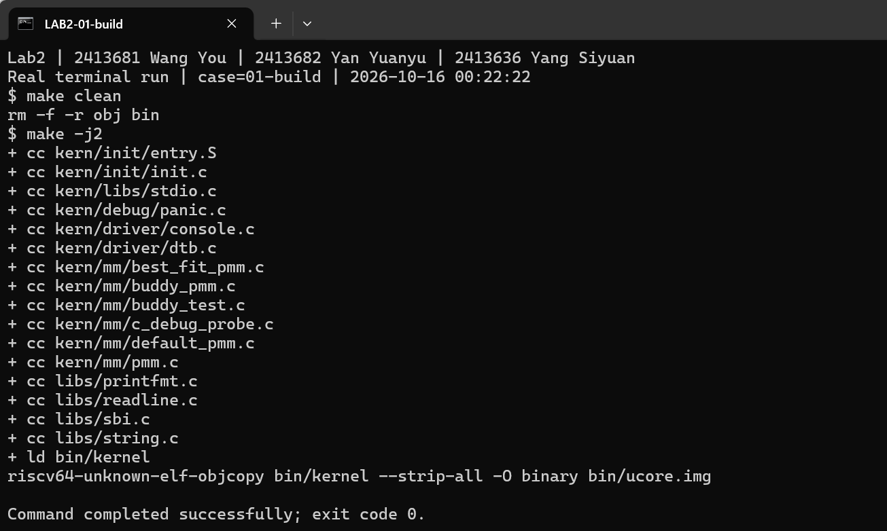
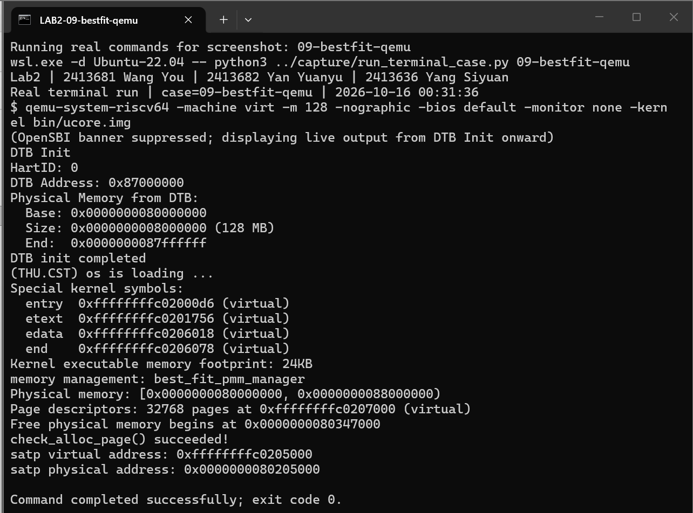
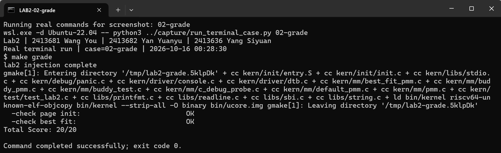
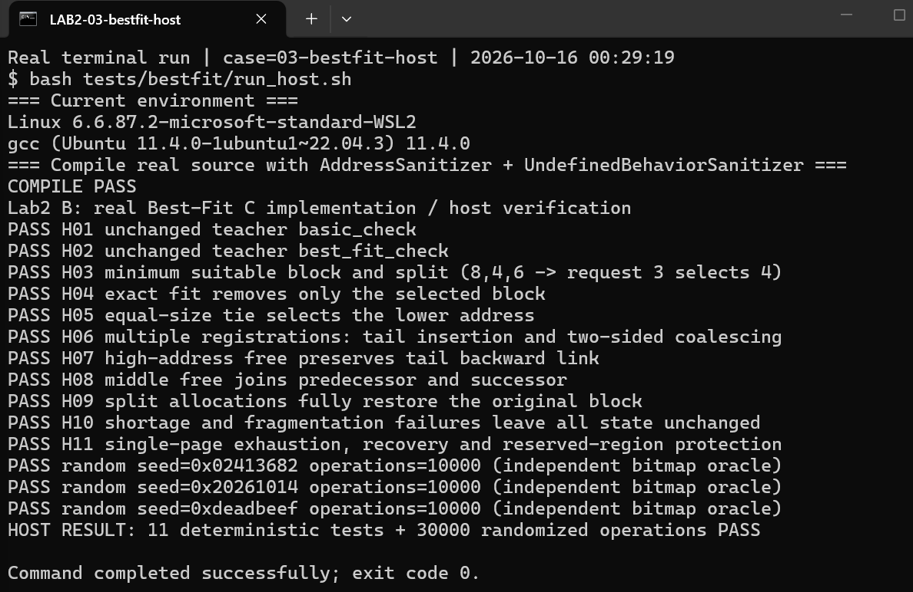
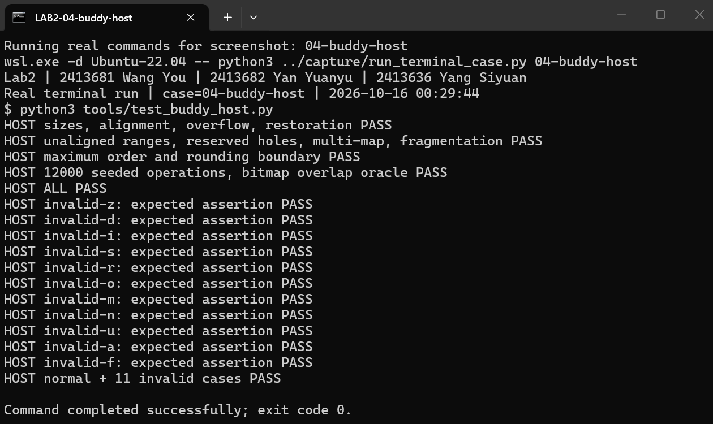
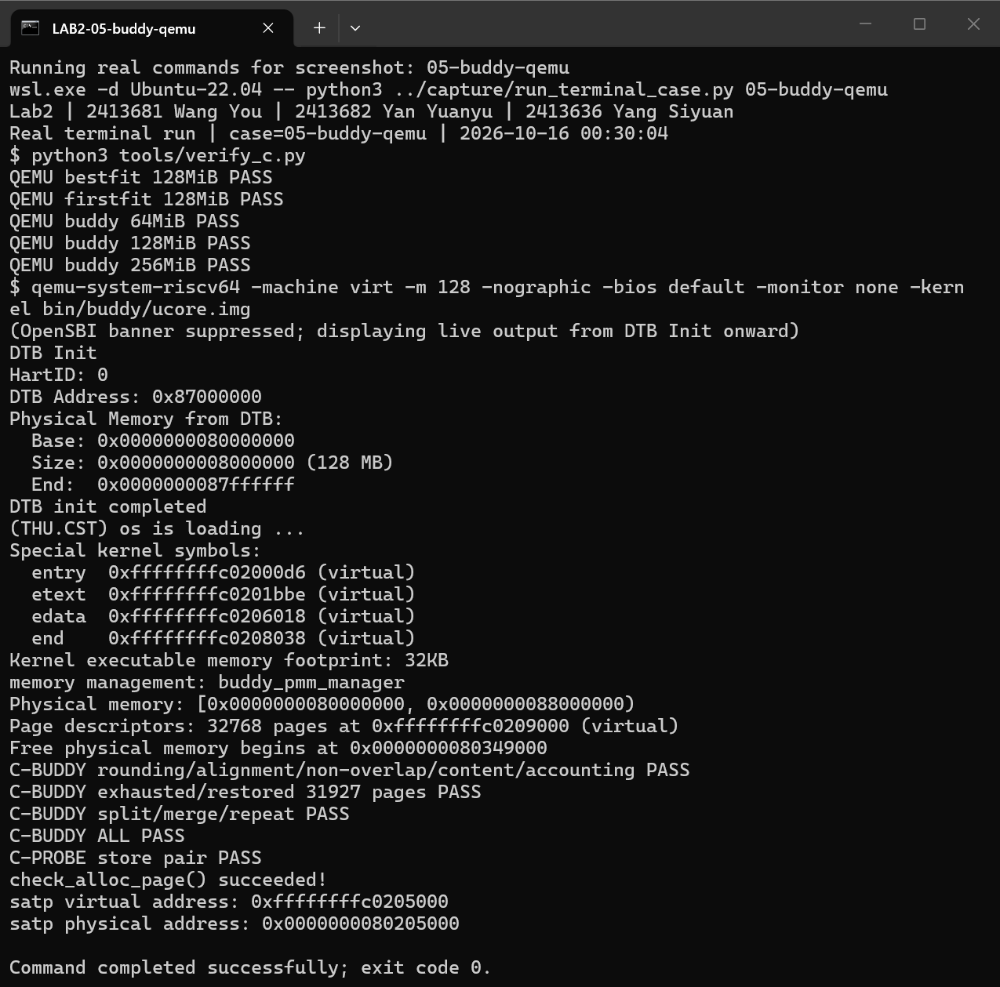
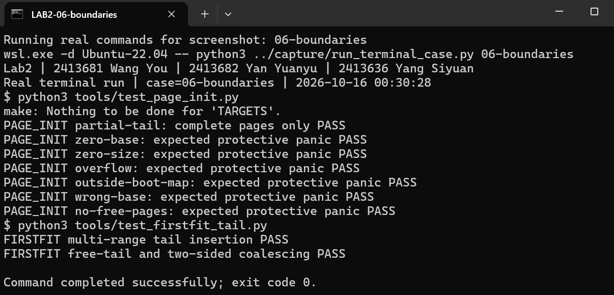
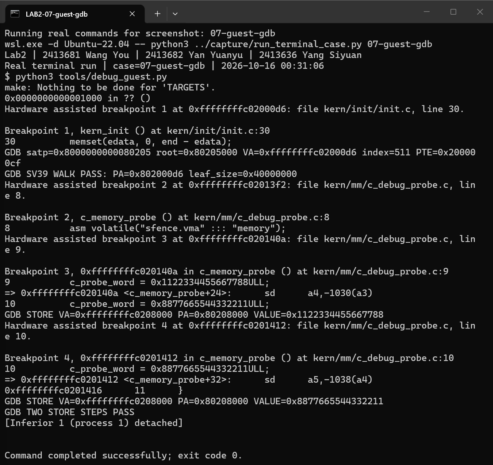

# 操作系统实验报告

## 实验基本信息

| 项目 | 内容 |
|------|------|
| 实验名称 | Lab2：物理内存和页表 |
| 小组成员 | 2413681－王优、2413682－严苑毓、2413636－杨思远 |
| 完成日期 | 2026-10-17 |

### 小组分工

| 成员 | 负责的练习/模块 | 报告内容 |
|------|----------------|----------|
| 2413681 王优 | 物理内存初始化：DTB 范围、page_init、描述符布局和保留区 | 物理内存发现、初始化与边界 |
| 2413682 严苑毓 | 连续物理页分配：First-Fit 分析、Best-Fit 实现、对照和回归 | 算法流程、改进分析、Best-Fit 测试；整合总报告和最终证据 |
| 2413636 杨思远 | Buddy 伙伴分配器、独立测试及 GDB 页表/访存/TLB 观察 | Buddy 规格、测试理由和调试记录 |

报告按文件夹《实验报告模板.md》的六章结构整理，依次说明初始化、分配策略、Buddy、调试过程和验证结果。代码采用王优的 page_init、严苑毓的 Best-Fit 和杨思远的 Buddy，位于提交包 [code/](../code/)。

## 一、实验目的

1. 通过 DTB 获得物理内存范围，建立 Page 描述符并保留固件窗口、内核和描述符数组。
2. 理解 First-Fit 的初始化、查找、拆分、回收与合并，实现 Best-Fit 并比较策略。
3. 实现 Buddy 的阶链表、伙伴定位与拆分合并，设计能检验状态、边界及实际内存内容的测试。
4. 用 GDB 观察 Sv39 根页表、真实访存指令，以及 QEMU 软件 TLB 的冷/热路径，区分描述符与页表。
5. 用结构化提示词约束 AI，再以真实编译、独立状态模型和内核执行检验结果。

## 二、实验环境

### 2.1 AI 编程工具与模型

| 成员 | AI 编程工具 | 底层模型 | 备注 |
|------|------------|---------|------|
| 2413681 王优 | ChatGPT | GPT-6.1-sol | 物理内存初始化、边界分析与报告整理 |
| 2413682 严苑毓 | ChatGPT | GPT-6.1-sol | First-Fit 分析、Best-Fit 实现、集成测试与总报告整理 |
| 2413636 杨思远 | ChatGPT | GPT-6.1-sol | Buddy 实现、独立测试与 GDB 调试 |

按任务设计四段式提示词，明确目标文件、依赖接口、函数清单和前后条件，再结合源码阅读、断言、独立位图及实际运行结果检查生成代码。四份最终规格汇总在 [prompt.md](prompt.md)，各模块的问题定位与规格调整见第四章。

### 2.2 操作系统与开发工具

| 项目 | 版本或配置 | 实验用途 |
|------|------------|----------|
| 宿主系统 | Windows x64，25H2，系统内部版本 26200.9711 | 文件管理与终端操作 |
| 宿主处理器 | Intel Core i7-14650HX，x86-64 | 运行 WSL、编译与模拟器 |
| Linux 环境 | WSL2，Ubuntu 22.04.5 LTS（发行版名 Ubuntu-22.04） | 源码构建、测试与调试 |
| Linux 内核 | 6.6.87.2-microsoft-standard-WSL2 | 提供 Linux 开发运行环境 |
| 终端 | Windows Terminal、WSL 命令行 | 执行命令并保存运行截图 |
| RISC-V 交叉编译器 | riscv64-unknown-elf-gcc 15.1.0 | 将内核 C/汇编源码编译为 RISC-V 目标文件 |
| 链接与二进制工具 | GNU Binutils 2.45：ld、objcopy、objdump | 链接内核、生成镜像及反汇编 |
| 宿主 C 编译器 | GCC 11.4.0 | 直接编译真实分配器的宿主测试 |
| 构建工具 | GNU Make 4.3 | 管理依赖、构建不同分配器后端和执行评分 |
| QEMU | 7.0.0 用于内核运行；4.1.1 的调试构建用于源码级访存分析 | 模拟 RISC-V 机器及观察软件 TLB |
| RISC-V 调试器 | GNU GDB 16.3.90.20250610-git | 断点、单步、寄存器与内存检查 |
| 测试脚本解释器 | Python 3.10.12 | 编排构建、QEMU、GDB 和结果检查 |
| 版本管理工具 | Git 2.34.1 | 小组仓库管理，实验分支为 lab2 |
| 宿主检测工具 | AddressSanitizer、UndefinedBehaviorSanitizer | 检查测试执行中的越界和未定义行为 |

工具版本与目标配置记录见 [environment_complete_20261017.json](logs/environment_complete_20261017.json)。

### 2.3 模拟硬件、固件与构建配置

| 项目 | 配置及作用 |
|------|------------|
| 目标平台 | RISC-V 64 位，QEMU virt，单 hart |
| 物理内存 | 默认 128 MiB；Buddy 另验证 64 MiB、256 MiB |
| 启动固件 | OpenSBI v1.0，Runtime SBI 0.3，固件物理基址 0x80000000 |
| 内核入口 | 物理入口 0x80200000，链接虚拟地址 0xffffffffc0200000，内核进入 S-mode |
| 地址转换 | Sv39；页面大小 4 KiB；启动根叶子映射覆盖 1 GiB DRAM 窗口 |
| 主要编译选项 | -std=gnu99、-mcmodel=medany、-O2、-g、-fno-builtin、-nostdinc |
| 链接配置 | tools/kernel.ld，ELF64 little-endian RISC-V，使用 -nostdlib 与 --gc-sections |
| 构建产物 | bin/kernel 保存 ELF 符号信息；bin/ucore.img 为 QEMU 加载的裸二进制镜像 |
| 运行方式 | -machine virt、-nographic、-bios default、-kernel；通过终端观察串口输出 |
| 客户机调试 | GDB 连接 QEMU gdbstub，自动脚本在本地分配端口，执行普通 GDB 命令 |
| 分配器选择 | 默认 Best-Fit；PMM_ALGO=firstfit 或 buddy 切换，各后端独立保存构建产物 |

在 WSL 的 code/ 目录执行 make 完成构建，make qemu 启动默认内核，make grade 运行评分；python3 tools/verify_all.py 执行组合验证。运行命令见第五章，编译与链接参数以 [Makefile](../code/Makefile) 和 [kernel.ld](../code/tools/kernel.ld) 为准。

本报告与 [prompt.md](prompt.md)、images/ 一同存放于 report/，实现源码存放于同级 code/，按小组仓库 lab2 分支提交。

## 三、实验整体逻辑分析

### 3.1 本章节的逻辑主线

```text
QEMU 装载固件和内核镜像
  -> MROM（复位 PC=0x1000）-> OpenSBI（0x80000000，M-mode 初始化）
  -> kern_entry（0x80200000，S-mode）：保存启动参数，设置 satp 和启动页表
       -> sfence.vma -> 设置高地址栈 -> 跳转 kern_init
  -> kern_init：清零 BSS -> dtb_init -> cons_init -> print_kerninfo -> pmm_init
       -> init_pmm_manager：选择分配策略并 init
       -> page_init：建立描述符、保留占用区、登记空闲页
       -> pmm_manager->check：检查分配、释放与合并
       -> 输出启动页表的虚拟/物理地址
  -> kern_init 循环等待
```

#### 物理页分配与地址翻译的关系

物理内存初始化负责建立可分配页面的初始状态：page_init() 读取设备树中的内存范围，为各物理页建立管理记录，将固件、内核和描述符数组占用的页面设为保留，再把剩余完整页登记为空闲。First-Fit、Best-Fit 和 Buddy 分配器在这些空闲页中选择满足请求的连续区域，并在释放时更新页面状态、空闲计数和空闲块结构。

`struct Page` 是内核用于记录一个物理页状态的结构体，其中保存引用计数、状态标记、块长度等管理信息。`alloc_pages(n)` 返回的是首个分配页的描述符指针，即 `struct Page *`。对该指针调用 `page2pa()`，得到对应物理页的起始物理地址；再加上直映偏移 va_pa_offset，即 `page2pa(p) + va_pa_offset`，得到内核能够用来访问该页内容的虚拟地址；Buddy 测试中的 page_data() 就使用这一转换。因此，描述符地址、对应页面的物理地址，以及访问页面内容的虚拟地址，是三个需要分别理解的地址。

页表负责记录虚拟地址到物理地址的映射。页表同样存放在内存中，其中的页表项称为 PTE：中间层条目指向下一级页表，叶子条目给出映射的物理地址基址和访问权限。CPU 的 satp 寄存器保存地址转换模式和根页表的物理页号；发生页表查询时，内存管理单元（MMU）从根页表出发，依据虚拟地址中的索引找到叶子条目，再结合相应的页内偏移得到物理地址。TLB 命中时可直接使用已缓存的翻译结果。本实验的启动页表使用根层叶子条目完成 1 GiB 映射，GDB 调试观察的就是这一实际映射。

这两类数据结构各有作用：Page 描述符供内核分配器管理物理页的占用状态；PTE 供地址转换机制确定访问哪个物理地址。分配器根据描述符选出页面，内核通过地址转换访问该页，二者共同完成内存的管理与使用。

#### 项目组成与文件协作

项目组织与启动链参考手册的[项目组成和执行流](references/oslab-lab1-project-flow.html)，结合本实验源码，各文件承担以下职责：

| 文件或目录 | 主要职责与协作关系 |
|------------|--------------------|
| [Makefile](../code/Makefile)、[tools/function.mk](../code/tools/function.mk) | 收集源文件、处理依赖，组织编译、链接、镜像生成及 QEMU/GDB 目标 |
| [tools/kernel.ld](../code/tools/kernel.ld) | 指定 kern_entry 入口和高地址链接布局，给出 etext、edata、end 等边界符号 |
| [kern/init/entry.S](../code/kern/init/entry.S) | 保存启动参数，设置启动页表与 satp，准备栈并进入 C 代码 |
| [kern/init/init.c](../code/kern/init/init.c) | 清零 BSS，依次完成设备树、控制台、内核信息和物理内存初始化 |
| [kern/driver/dtb.c](../code/kern/driver/dtb.c) | 解析设备树，向 page_init 提供 DRAM 基址和大小 |
| [kern/mm/pmm.c](../code/kern/mm/pmm.c)、[pmm.h](../code/kern/mm/pmm.h) | 实现公共 PMM 接口、管理器选择和物理页初始化，将机制与分配策略连接起来 |
| [memlayout.h](../code/kern/mm/memlayout.h)、[mmu.h](../code/kern/mm/mmu.h) | 定义 Page、空闲区、页大小、页表项和地址相关常量 |
| [default_pmm.c](../code/kern/mm/default_pmm.c)、[best_fit_pmm.c](../code/kern/mm/best_fit_pmm.c)、[buddy_pmm.c](../code/kern/mm/buddy_pmm.c) | 实现 First-Fit、Best-Fit 和 Buddy 三种页分配策略 |
| [buddy_test.c](../code/kern/mm/buddy_test.c)、[c_debug_probe.c](../code/kern/mm/c_debug_probe.c) | 执行内核页内容与状态检查，提供可观察的真实访存指令 |
| [kern/libs/stdio.c](../code/kern/libs/stdio.c)、[libs/printfmt.c](../code/libs/printfmt.c)、[libs/sbi.c](../code/libs/sbi.c) | 完成格式化输出和 SBI 调用，把启动与测试信息输出到终端 |
| [tests/](../code/tests/)、[tools/](../code/tools/) | 提供宿主测试、评分、QEMU 多配置和 GDB 自动检查 |

#### 从源代码构建到内核运行

1. **编译与汇编源文件。** 执行 make 后，Makefile 根据依赖关系调用 RISC-V 工具链，将各个 `.c` 和 `.S` 文件分别转换成 `.o` 目标文件，保存在 obj/ 中。此时每个目标文件只包含相应源文件生成的代码和数据，跨文件的函数、变量引用由后续链接处理。

2. **链接为带符号的内核文件。** RISC-V 链接器读取 tools/kernel.ld，把各目标文件的代码段、只读数据段、数据段等安排到规定位置，并解析跨文件引用，生成 ELF 格式的 bin/kernel。链接脚本指定入口符号 kern_entry，以及从 0xffffffffc0200000 开始的虚拟地址布局；生成的符号信息供 GDB 定位函数、变量和源码。

3. **生成供 QEMU 加载的镜像。** Makefile 调用 objcopy，将 bin/kernel 转换为裸二进制文件 bin/ucore.img。运行时 QEMU 加载 ucore.img，调试时 GDB 从 bin/kernel 读取符号信息，二者由同一次内核构建生成。

4. **启动模拟机器并进入内核入口。** 执行 make qemu 后，QEMU 建立 virt 模拟平台，将 OpenSBI 固件与内核镜像装入模拟物理内存。CPU 从复位代码进入位于 0x80000000 的 OpenSBI；OpenSBI 完成固件和特权级相关初始化后，将控制权交给物理地址 0x80200000 处的内核入口 kern_entry，内核在 S-mode 执行。

5. **完成汇编入口和 C 语言初始化。** kern_entry 定义在 entry.S 中，保存 hart 编号和设备树地址，设置启动页表与 satp、刷新 TLB、建立栈，然后跳转到 kern_init()。kern_init() 清零 BSS，解析设备树，初始化控制台并输出内核信息，随后调用 pmm_init()，完成分配器选择、物理页初始化及分配器自检。

### 3.2 功能的逐步实现

1. **首先完成物理内存探测与初始化，由王优负责。** 从设备树（DTB）读取物理内存范围，明确物理页编号以及虚拟地址与物理地址之间的转换关系，完成 page_init()。该函数建立 Page 描述符，保留固件、内核和描述符数组占用的页面，把剩余完整页交给分配器。后续分配算法都以这些页面和描述符为基础。

2. **接着理解 First-Fit 并实现 Best-Fit，由严苑毓负责。** 阅读现有 First-Fit 的登记、分配、释放和合并过程，再实现 Best-Fit：从足够大的空闲块中选择最小的一块，分配后保留余块，释放时合并相邻空闲块，并将其设为默认分配器。

3. **然后实现 Buddy 伙伴分配器，由杨思远负责。** 沿用相同的物理内存管理器（PMM）接口和 Page 描述符，按二次幂大小组织空闲块，完成块的分裂与伙伴合并。申请页数向上取整到二次幂，例如申请 3 页实际占用 4 页，空闲计数也按 4 页更新。

4. **先检查算法，再检查内核运行。** 在 WSL 中用宿主 GCC 直接编译分配器源码，通过确定性案例、随机操作和独立位图核对分配区间、页数与释放合并；随后用 RISC-V 交叉编译器构建内核，在 QEMU 中检查初始化、分配器自检和实际页面读写。

5. **最后用 GDB 检查地址翻译和访存结果。** 读取 satp 与页表项，计算虚拟地址对应的物理地址，再单步执行两条存储指令，检查数据是否写入预期位置，将分配器管理的页面与实际访存结果对应起来。

### 3.3 模块整合与环境适配

1. 合并版本保留王优的 page_init()、严苑毓的 best_fit_pmm.c，以及杨思远的 buddy_pmm.c、buddy_pmm.h、buddy_test.c 和 c_debug_probe.c；Page/PMM ABI 与老师测试保持一致。
2. entry.S 根项 2 增加 0x80000000 起的 1 GiB 恒等映射，保留项 511 的高地址直映。保证写 satp 后仍在物理 PC 执行的过渡指令可取指；否则本机曾在 0x80200038 报取指页故障。该适配已加入最终源码。
3. Makefile 使用 -kernel 加载，避免本机旧 loader 方式导致 OpenSBI Next Address 为零；不同后端分别构建。
4. make grade 在唯一临时目录注入测试，结束清理自己的副本；评分条件不变。等待最后测试标记而非固定睡 1 秒，并清理本次 QEMU 子进程，避免启动慢造成假失败。
5. 客户机调试使用普通 GDB 命令与外部反汇编取得实际指令地址；脚本换行统一 LF。日志读取必须等最终完整行，panic 也须等完整原因，避免中途终止而截断证据。

## 四、实验内容与实现

本章按报告模板依次组织“功能模块”“练习”和“Challenge”。功能模块按手册中的实现任务顺序展开；练习集中回答算法分析与 GDB 分支问题；Challenge 单列已完成的物理内存范围获取思考题。各项与手册的对应关系如下。

| 手册中的任务 | 本报告位置 | 负责人 |
|--------------|------------|--------|
| 功能模块一·任务一：物理内存探测与页描述符初始化 | 4.1 功能模块 | 王优 |
| 功能模块二·任务二：Best-Fit 实现、默认管理器与提示词 | 4.2 功能模块 | 严苑毓 |
| 功能模块二·任务三：Buddy 实现、独立测试及两份提示词 | 4.3 功能模块 | 杨思远 |
| 功能模块二·任务一：First-Fit 流程与改进问题 | 4.4 练习 | 严苑毓 |
| 功能模块二·任务二附带问题：Best-Fit 改进空间 | 4.5 练习 | 严苑毓 |
| 分支任务：GDB 页表查询、TLB 冷热访问与 Bare 对照 | 4.6 练习 | 杨思远 |
| Challenge：硬件的可用物理内存范围的获取方法（思考题） | 4.7 Challenge | 王优 |
| 选做 Challenge：SLUB 对象分配 | 6.3 后续拓展思考 | 小组 |

### 4.1 功能模块：物理内存探测与页描述符初始化

**负责人：** 2413681-王优

#### 模块功能描述

**需要实现/修改的函数：**

```c
static void page_init(void);
```

**功能说明：** 本模块将设备树给出的 DRAM 字节范围转换为内核可管理的物理页集合。它处理地址边界、页对齐、描述符容量及保留区域；成功初始化后，通过当前管理器的 `init_memmap()` 把空闲页交给后续分配模块。调用顺序为 `pmm_init()` 先初始化 PMM，再调用 `page_init()` 登记可用页。

#### 功能规格与实现流程

1. 将 `va_pa_offset` 设置为框架规定的 `PHYSICAL_MEMORY_OFFSET`。
2. 检查 DTB 基址、大小与加法溢出；DRAM 基址必须与固定 `nbase` 相符且按页对齐。
3. 当前启动页表只映射 DRAM 起始的 1 GiB 窗口；超出这个窗口的范围拒绝管理。不完整的末尾页向下对齐后排除。
4. 在内核 `end` 后向上按 4 KiB 对齐放置 `Page` 数组，覆盖 `[nbase,npage)` 的所有页。
5. 检查描述符乘法、地址加法及向上对齐的溢出，并在写数组前确认内核、数组和至少一个空闲完整页都能放入物理范围。
6. 先把所有描述符置为保留，再由当前 PMM 的 `init_memmap()` 将可用范围改为空闲状态。固件、内核与数组页面保持保留状态。
7. 输出范围、描述符数量和空闲起点，以支持运行核验。

#### 关键变量与地址转换

| 变量 | 准确含义 |
| --- | --- |
| `nbase` | DRAM 首个物理页号：`0x80000000 / 4096 = 0x80000` |
| `npage` | **可管理末端对应的排他页号上界**，不是本机实际页数量 |
| `npage-nbase` | 本次需要建立描述符的物理页数量 |
| `pages` | 描述符数组的内核虚拟地址；`pages[0]` 对应页号 `nbase` |
| `va_pa_offset` | 内核直映区的虚实地址偏移，值为 `0xffffffff40000000` |
| `free_pa` | 描述符数组结束后，第一个完整可分配页的物理起点 |

转换关系：

```text
PA = KVA - va_pa_offset
PPN = PA >> 12
Page 数组索引 = PPN - nbase
page2pa(p) = (p - pages + nbase) << 12
```

上述固定偏移对应本实验的内核直映区；一般地址空间根据页表定义的映射关系完成转换。

#### 描述符布局与保留状态

先计算 `pages_va = ROUNDUP(end, PGSIZE)`，再计算数组末端和页对齐的 `free_pa`。这一步在真正写描述符之前完成，防止数组越界时先破坏内存再报错。

随后逐个初始化描述符的 `flags`、`property`、引用计数，并设置 `PageReserved`。最后仅对 `[free_pa,mem_end)` 调用 `init_memmap()`；该接口清除这些页的保留状态并建立初始空闲结构。这种“先全部保留，再明确开放可用区”的顺序减少误把保留页交给分配器的风险。

本实现按 QEMU 的单段 DRAM 布局管理页面，内核物理起点之前的 2 MiB 作为整体启动保留窗口。OpenSBI 镜像位于该窗口内，固件实际大小见启动日志。面向更复杂的硬件时，可在当前 DTB 解析基础上扩展多段内存及 reserved-memory/memreserve 处理。

#### 默认 128 MiB 构建的布局计算

DRAM 范围为 `[0x80000000,0x88000000)`。下列数值对应最终 Best-Fit 内核。

| 项目 | 结果 |
| --- | --- |
| DTB DRAM 范围 | `[0x80000000,0x88000000)`，128 MiB |
| 页大小 / 描述符数量 | 4096 字节 / 32768 |
| `nbase / npage` | `0x80000 / 0x88000` |
| 数组虚拟起点 | `0xffffffffc0207000` |
| 数组物理起点 | `0x80207000` |
| `sizeof(struct Page)`（本机 RV64 ABI） | 40 字节 |
| 数组占用 | `32768 × 40 = 1310720` 字节，即 320 页 |
| 可分配物理起点 | `0x80347000` |
| 可分配页数 | `(0x88000000-0x80347000)/4096 = 31929` |

总页数 32768 减去空闲页数 31929，得到保留页 839；由低端保留窗口 512 页、内核到数组起点的 7 页、描述符数组 320 页组成。页级对齐占用和日志中的“内核有效镜像 KB”是不同统计口径。

页描述符与物理页一一对应，但二者所占字节数不同：本实验 RV64 ABI 下一个 Page 描述符占 40 字节，一个物理页占 4096 字节。描述符指针增加 1，表示转到下一个物理页的管理记录；page2pa() 根据描述符索引计算其对应的物理页地址。

初始化顺序先由 init_pmm_manager() 建立分配器内部状态，再由 page_init() 调用 init_memmap() 登记空闲页。这样登记时链表与计数已经处于有效初始状态。默认启动及布局记录见[内核运行日志](logs/qemu/bestfit-128MiB.log)。

#### 最终提示词

````markdown
[PROMPT]

任务：在 kern/mm/pmm.c 的 lab2 function1 标记处完成物理内存初始化，使内核能够依据 DTB 建立 Page 描述符，保留已占用区域，并把剩余完整页交给当前物理页分配器。
操作要求：直接修改工程中的实际文件；实现范围为 page_init() 及其内部辅助逻辑。沿用现有 DTB 解析、启动映射、公共头文件和 PMM 接口，保留原检查函数、lab2 标记及负责人学号。
输出要求：交付可构建的源码，输出管理的物理范围、描述符数量及地址、空闲起点；执行构建和初始化边界检查，记录命令、结果及异常原因。

[RELY]

- get_memory_base()/get_memory_size() 返回字节单位的 DRAM 基址和长度。
- PGSIZE、PPN、ROUNDUP/ROUNDDOWN、PHYSICAL_MEMORY_OFFSET、PADDR、pa2page、链接符号 end，以及 nbase=DRAM_BASE/PGSIZE。
- struct Page 的 flags、property、ref，SetPageReserved、set_page_ref，以及已初始化的 pmm_manager->init_memmap(base,n)。
- 当前 QEMU virt 使用从 DRAM_BASE 起的固定基址单段 DRAM，启动页表覆盖其中的 1 GiB 窗口。

[GUARANTEE]

```c
static void page_init(void);
```

该函数建立 va_pa_offset、npage、pages 和当前 PMM 的初始空闲状态，供 pmm_init() 后续检查和分配使用。

[SPECIFICATION]

## page_init

Pre-Condition：DTB 解析完成，内核运行于规定直映区，当前 PMM 已执行 init。

Post-Condition（成功）：va_pa_offset 等于工程规定的直映偏移；npage 是管理范围末端的排他物理页号；pages[0] 对应 nbase，数组共有 npage-nbase 项。描述符数组从 ROUNDUP(end,PGSIZE) 开始。固件窗口、内核和描述符数组占用的页面保持 Reserved；数组之后到管理末端的完整页已登记到当前 PMM，初始空闲页数与该区间页数一致。

Case 1（有效范围）：物理末端按页向下对齐；尾部不足一页的字节位于管理范围之外。每个描述符与物理页一一对应，初始引用计数为 0。
Case 2（非法范围）：零基址、零长度、地址加法溢出、非对齐或非预期基址、超出启动映射窗口时，打印原因并 panic。
Case 3（元数据容量不足）：描述符长度计算或对齐溢出、内核与数组占满可用内存时，打印原因并 panic；数组写入和空闲区登记以全部容量检查通过为前提。

Requirements：使用现有地址转换与 PMM 接口维持系统协作。实际构建并启动内核；通过 GDB 修改 DTB 解析后的参数，分别验证正常尾页、零基址、零长度、加法溢出、映射越界、错误基址和可用空间耗尽。正常案例核对地址、页数和状态，异常案例核对对应 panic。
````

#### 实现迭代过程

以下按已有实现和检查记录整理各次问题、规格调整及结果。

##### 第一次迭代：适配裸机编译环境

**遇到的问题：** 早期实现使用了 `UINT64_MAX`，当前裸机头文件未提供该定义。

**问题解决策略：** 将无符号上限表达为 `~(uint64_t)0`，沿用工程已有类型和头文件。提示词的依赖范围明确为当前框架提供的宏、类型和接口。

**结果：** 初始化代码完成裸机编译，进入后续运行检查。

##### 第二次迭代：提前验证描述符数组容量

**遇到的问题：** 复核发现容量检查应先于描述符数组写入，才能使边界异常在元数据写入前得到处理。

**问题解决策略：** 先计算描述符数量、数组末端与对齐后的空闲起点，并检查乘法、地址加法和对齐溢出；把“全部容量检查通过后再写数组”明确写入最终规格。

**结果：** 内核、描述符数组和空闲区的范围关系在写入前完成核对。

##### 第三次迭代：尾页对齐与启动映射边界

**遇到的问题：** 新增尾页测试在旧实现上因末端未按页对齐而 panic；初始化还需要遵守当前启动页表的直映窗口。

**问题解决策略：** 根据手册对完整页的要求，将物理末端向下按页对齐；补充启动直映窗口上界检查。最终规格明确正常尾页、容量不足和映射越界时的处理结果。

**结果：** 原先失败的尾页测试通过，GDB 注入的超界范围进入预期保护路径。

**最终结果：** 编译与内核启动通过，七项初始化边界检查通过；地址、描述符数量、空闲页数及异常原因与规格一致，见[初始化检查日志](logs/final-review-20261017/acceptance/page-init.log)。

**关键改进点总结：** 裸机依赖与工程一致；容量校验先于写入；完整页对齐与启动映射范围分别检查。

---

### 4.2 功能模块：Best-Fit 连续物理内存分配

**负责人：** 2413682-严苑毓

#### 模块功能描述

**需要实现/修改的函数：**

```c
static void best_fit_init(void);
static void best_fit_init_memmap(struct Page *base, size_t n);
static struct Page *best_fit_alloc_pages(size_t n);
static void best_fit_free_pages(struct Page *base, size_t n);
static size_t best_fit_nr_free_pages(void);
static void best_fit_insert_block(struct Page *base);
static void best_fit_merge_block(struct Page *base);
static void init_pmm_manager(void);  // pmm.c 中选择默认管理器
const struct pmm_manager best_fit_pmm_manager;
```

**功能说明：** 本模块从初始化模块登记的空闲页中选择最小的合适连续块，处理精确匹配、拆分、空间不足、释放及邻接合并。通过 `pmm_manager` 向公共 `alloc_pages()`、`free_pages()` 和 `nr_free_pages()` 提供操作，并由 `init_pmm_manager()` 设为默认后端。

此外新增静态的 `best_fit_insert_block()` 与 `best_fit_merge_block()`，复用地址插入和邻接合并逻辑。正式实现见 [best_fit_pmm.c](../code/kern/mm/best_fit_pmm.c)，管理器选择见 [pmm.c](../code/kern/mm/pmm.c)。

#### 实现方法

链表继续按物理地址排列，分配时扫描块长度，选择所有足够大块中最小的一块。相同大小时保留先找到的低地址块；遇到恰好满足 n 页的块可以提前结束，因为不可能再找到更小的合适块。

```c
if (p->property >= n && (best == NULL || p->property < best->property)) {
    best = p;
    if (p->property == n) {
        break;
    }
}
```

例如三个相互分离的空闲块按地址排列，长度分别为 8、4、6 页，申请 3 页。First-Fit 选择 8 页块；Best-Fit 选择 4 页块，分配其前 3 页，并留下 1 页。该例展示两种选择策略的区别，长期效果还取决于后续申请和释放序列。

选择块后，先记住其前驱并摘除节点。如果还有余量，用 `best + n` 作为剩余块首页，设置余量长度及首页标记，并插回原来的地址位置。分配出去的首页清除空闲标记和长度，`nr_free` 恰好减少 n。

回收时清零页面的引用计数和旧状态，设置新块首页，按地址插入，再依次检查前后邻居。合并时扩大保留首页的长度，清除被合并节点的首页标记和长度，并从链表摘除该节点。合并不会新增页面，所以它不另外改变 `nr_free`。

登记新空闲区也复用合并辅助函数，可以处理多个区间登记后刚好相邻的情况。插入辅助函数先找到位置，再调用一次 `list_add_before`；在哨兵前插入就是尾插，避免继续遍历新节点。

主要状态约定为：链表按地址严格递增，各空闲块不重叠且已合并相邻块；只有块首页具有首页标记；所有空闲块的 property 之和等于 `nr_free`；保留页不进入分配范围。调用者持有待释放区间，并按相应的块起点和页数归还；测试通过独立位图核对区间持有状态。

#### 与系统的连接

best_fit_pmm_manager 将初始化、空闲区登记、分配、释放和计数函数注册到统一 PMM 接口，check 成员绑定原有 best_fit_check()。init_pmm_manager() 默认选择该管理器；选择 Buddy 或 First-Fit 时复用相同公共接口。

```c
pmm_manager = &best_fit_pmm_manager;
```

随后公共 alloc_pages()/free_pages()/nr_free_pages() 经函数指针调用对应操作。page_init() 负责提供可用页范围，Best-Fit 负责组织和使用这些页；两者通过 init_memmap() 连接。

#### 最终提示词

````markdown
[PROMPT]

任务：结合 kern/mm/default_pmm.c 解释 First-Fit 的初始化、登记、分配、释放和合并；在 kern/mm/best_fit_pmm.c 的 lab2 function2-2 标记处完成 Best-Fit 连续物理页管理模块，并在 pmm.c 的 init_pmm_manager() 默认选择 best_fit_pmm_manager。Best-Fit 从所有足够大的空闲块中选择长度最小者，长度相同时选择低地址块。
操作要求：直接修改实际文件；实现范围为 Best-Fit 管理器、模块内 static 辅助函数及默认管理器选择。保留 basic_check()/best_fit_check() 全文、公共 Page/free_area_t/pmm_manager 结构和宏、lab2 标记与负责人学号，沿用物理内存初始化模块提供的接口。
输出要求：交付完整源码与注册结果；说明 First-Fit 和 Best-Fit 的选择差异、复杂度及改进方向。实际编译、运行原检查与补充测试，保存命令和输出；启动输出应显示当前管理器为 best_fit_pmm_manager。

[RELY]

- Page 的 ref、flags、property、page_link；free_area_t 的 free_list、nr_free。
- PageReserved、PageProperty、SetPageProperty/ClearPageProperty、set_page_ref 和 assert。
- list_init、list_next/list_prev、list_add/list_add_before、list_del、le2page 等当前链表接口。
- pmm_manager 的 init、init_memmap、alloc_pages、free_pages、nr_free_pages、check，以及公共分配接口的转发约定。
- 原检查函数对模块内 free_list 和 nr_free 的访问及状态约定。

[GUARANTEE]

```c
static void best_fit_init(void);
static void best_fit_init_memmap(struct Page *base, size_t n);
static struct Page *best_fit_alloc_pages(size_t n);
static void best_fit_free_pages(struct Page *base, size_t n);
static size_t best_fit_nr_free_pages(void);
const struct pmm_manager best_fit_pmm_manager;
```

上述函数经管理器注册供公共 PMM 接口调用；模块内部辅助函数使用 static。

[SPECIFICATION]

## best_fit_init

Pre-Condition：建立一套新的分配器状态。
Post-Condition：空闲链表为空，nr_free=0。

## best_fit_init_memmap

Pre-Condition：n>0，base 起的 n 个描述符有效且均为 Reserved，区间由初始化模块确认为可分配页。
Post-Condition：新登记页的引用计数为 0，Reserved 状态已清除；所有空闲块按地址递增排列，物理相邻块已合并。仅空闲块首页具有 PageProperty，首页 property 等于块长，nr_free 增加 n。
Case：分离区间分别保留；与既有空闲块相邻的区间形成连续大块。n=0 时触发断言。

## best_fit_alloc_pages

Pre-Condition：正常请求满足 n>0；空闲块互斥，地址顺序、首页标记、块长与 nr_free 一致。
Post-Condition（成功）：返回最小合适块起点，交付其前 n 个连续页；等长块选择低地址者。返回区间与其他持有区间互斥，各页引用计数为 0，分配首页的 PageProperty 已清除且 property=0，nr_free 减少 n。
Case 1（精确匹配）：整块从空闲集合移除；找到精确匹配后可结束搜索。
Case 2（所选块更大）：剩余部分成为地址有序的空闲块，其首页标记和长度准确。
Case 3（分配失败）：n 超过空闲总数，或总数足够但不存在 n 页连续块时返回 NULL；链表、页状态和 nr_free 保持调用前状态。
Case 4（非法请求）：n=0 时触发断言。

## best_fit_free_pages

Pre-Condition：正常调用传入 n>0 的有效区间，调用者持有其中全部页面，区间与当前空闲集合互斥；这些页的 Reserved 和 PageProperty 均已清除。
Post-Condition：回收页的引用计数为 0，nr_free 增加 n；回收区间在空闲集合中出现一次，所有物理连续邻块合并为一个块，链表保持地址递增。合并后仅新块首页保留 PageProperty 与正确块长，原首页转为内部页时 property=0。
Case：分别覆盖链首、链中、链尾插入，以及与前块、后块、双侧相邻和完全分离的情况。n=0 时触发断言。
Requirements：单次回收的计数增量恰为 n，邻块合并保持空闲页总数；完整分配后再释放可恢复原有空闲覆盖。

## best_fit_nr_free_pages 与管理器注册

Pre-Condition：管理器初始化完成，空闲集合一致。
Post-Condition：查询返回当前空闲页总数，查询前后状态一致；管理器名称为 best_fit_pmm_manager，check 绑定原 best_fit_check，pmm.c 默认选择该管理器。

Requirements（模块验证）：直接编译真实 C 源码并保留原检查。用确定性案例核对最小块、等长选择、精确/拆分、尾插、双向合并、多区间及失败状态；用独立位图核对空闲覆盖、持有区间互斥和计数。保留本次 11 项确定性与三种种子各 10,000 次随机操作，启用 ASan/UBSan，最终在 RISC-V/QEMU 中启动并执行 make grade。各条规格应可对应到断言、源码检查或运行记录。
````

#### 实现迭代过程

以下按已有开发记录整理构建适配与链表状态检查中的问题和修正。

##### 第一次迭代：管理器注册与宿主构建

**遇到的问题：** 源码检查时需要调整管理器注册位置，使其引用已定义的检查函数；宿主测试初次构建存在内核头文件与宿主标准库同名的问题。

**问题解决策略：** 明确保留原检查函数及其状态约定，管理器注册按已有定义组织。宿主构建将标准库头与内核头的搜索次序分开：测试适配头提供必要的宿主接口，`libs/` 使用 `-idirafter`，避免同名 `stdio.h`、`string.h` 遮蔽标准库。最终提示词明确实际依赖及原检查函数的保留要求。

**结果：** 真实分配器 C 源码能够进入宿主检查，老师提供的 `basic_check()` 和 `best_fit_check()` 保持原样。

##### 第二次迭代：尾插边界与独立状态验证

**遇到的问题：** 参考实现的尾插逻辑可能在插入后继续遍历新节点，破坏链表。仅检查分配返回值，还需要进一步核对空闲覆盖和计数。

**问题解决策略：** 将“回收区间在空闲集合中恰好出现一次、链表双向关系正确”写入可验证要求；实现中用静态辅助函数完成定位、单次插入和邻块合并。用独立位图逐页核对空闲覆盖、持有区间互斥、计数及失败状态。

**结果：** 参考实现触发尾插断言，当前实现通过同一回归；11 项确定性案例与三种种子共 30,000 次随机操作通过。

**最终结果：** 原检查、独立宿主检查、RISC-V 内核启动及 `make grade` 均通过，评分为 20/20。源文件版本与原检查保留范围见[源码审计记录](logs/source_audit.json)。

**关键改进点总结：** 以真实框架状态约定组织注册和实现；把地址有序插入与最小块选择分别处理；通过独立位图验证实现效果。

---

### 4.3 功能模块：Buddy System 分配与独立测试

**负责人：** 2413636-杨思远

#### 模块功能描述

**需要实现/修改的函数：**

```c
static void buddy_init(void);
static void buddy_init_memmap(struct Page *base, size_t n);
static struct Page *buddy_alloc_pages(size_t n);
static void buddy_free_pages(struct Page *base, size_t n);
static size_t buddy_nr_free_pages(void);
static size_t span(unsigned order);
static size_t checked_index(struct Page *p, size_t n);
static unsigned request_order(size_t n);
static void link_block(size_t index, unsigned order);
static void coalesce(size_t index, unsigned order);
void buddy_validate(void);
void buddy_check(void);
const struct pmm_manager buddy_pmm_manager;
```

**功能说明：** 本模块在统一 PMM 接口下按二次幂组织页面，处理不规则区间登记、块分裂、伙伴合并、整块回收和分配失败。初始化模块提供可用页；`PMM_ALGO=buddy` 选择该管理器；独立宿主测试核对算法状态，内核测试验证实际页面读写和耗尽恢复。请求页数与实际块大小的约定见下文。

#### 数据结构与状态约定

实现文件：kern/mm/buddy_pmm.c、buddy_pmm.h；内核测试：buddy_test.c。

每阶一个链表，0阶1页，1阶2页，依此至18阶。块头用 Page.page_link 连接。
Page.property 在空闲块头和分配块头保存实际页数；只有空闲头具有 PG_property。
分配页使用 flags bit2 标记，普通内页 property 为0，ref 为0。
沿用框架结构体大小，块信息保存在已有 Page 描述符中。

| 核心函数 | 在模块中的作用 |
|----------|----------------|
| buddy_init() | 清空各阶链表和计数 |
| buddy_init_memmap() | 检查待登记范围，拆成对齐幂次块并尝试合并 |
| buddy_alloc_pages() | 将请求取整到对应阶，选择或分裂空闲块 |
| buddy_free_pages() | 验证完整分配块，恢复实际页数并合并伙伴 |
| buddy_nr_free_pages() | 查询当前空闲的实际页数 |
| buddy_validate() | 核对块对齐、范围、页状态、链表、计数及合并完整性 |
| buddy_check() | 通过管理器 check 接口运行内核测试 |


#### 初始化与不规则区间登记

init 清空所有阶链表和空闲计数。init_memmap 先验证全部页面为 Reserved，随后清理状态。
按区间剩余长度和起点索引对齐，选择当前能容纳的最大二次幂块逐个登记。
每次登记尝试合并现有同阶伙伴，因此相邻、分次甚至反序登记的区间也能合并。

索引是 `page - pages`；伙伴是 `index XOR (1<<order)`。
本框架 DRAM_BASE=0x80000000，nbase=0x80000，在最大阶上也对齐，因此索引对齐对应物理地址对齐。
合并要求块的阶数相同，并且索引满足异或伙伴关系。例如索引 4、8 处的两个 4 页块分属不同的 8 页区间，分别与索引 0、12 处的块配对。

#### 分配、分裂、回收与合并

申请 n>0 页，取 `actual=2^ceil(log2(n))`，从目标阶向上找首个非空链表。
移除一个块，持续一分为二：一半继续分裂，另一半挂回对应阶。
返回分配头，空闲计数减 actual。空间不足、碎片导致无足够阶、超过18阶均返回 NULL，计数不变。

例如申请3页实际取得4页。调用者释放时仍使用 `free_pages(base,3)`，恢复4页。
释放以完整分配块为单位，调用者保存块起点和原始请求页数。回收时计算伙伴，仅对范围内的同阶空闲伙伴摘链合并，在达到最大阶或不存在合适伙伴时结束。

#### 调用约定与边界处理

- 当前调用按单 hart 顺序执行；扩展并发分配时需对共享阶链表和计数增加同步。
- 0页请求视为调用错误，触发断言；过大正数返回 NULL。
- 检查重复释放、内部指针、保留/越界页面和不同取整阶的大小不符。
- property 保存实际幂次块长，原始请求 n 由调用方保存；释放检查实际块长对应的阶，并按原 n 成对调用。
- 释放前逐页确认 ref=0，再回收整个实际分配块。
- 内部碎片是设计取舍：3页消耗4页，5页消耗8页。
- buddy_validate 在测试与调试阶段检查完整结构；日常分配和释放执行阶操作并维护实际页状态，因此完整操作成本为 O(阶数+实际页数)。

#### 最终提示词

##### 提示词一：实现

````markdown
[PROMPT]

任务：在当前 ucore 物理内存框架内完成 Buddy 分配模块，交付 kern/mm/buddy_pmm.c/.h，并通过 pmm.c 和 Makefile 接入。模块按二次幂块管理空闲页，支持分裂、伙伴合并及整块回收；请求 n 页时实际交付向上取整的幂次块。
操作要求：直接修改实际文件，修改范围为 Buddy 模块及管理器、构建选择位置；沿用公共 ABI，保留物理内存初始化、Best-Fit 的最终实现和原检查函数。默认 Best-Fit，PMM_ALGO=buddy 选择 Buddy，各后端使用独立对象目录。
输出要求：交付可构建的源码与结构验证接口，说明实际占用、计数和释放约定，并记录后端构建与检查结果。

[RELY]

- pmm_manager 允许分配至少 n 页，空闲计数反映实际占用；公共 alloc_pages/free_pages 经当前管理器转发。
- Page.property、flags、ref、page_link，Reserved/Property 状态及双向循环链表接口。
- pages[0] 对应 nbase=0x80000，该页号在最大 2^18 页边界上对齐；npage-nbase 表示描述符容量。
- 物理内存初始化模块交给 init_memmap 的区间具有有效且处于 Reserved 状态的描述符；当前内核按单 hart 顺序执行。

[GUARANTEE]

```c
static void buddy_init(void);
static void buddy_init_memmap(struct Page *base, size_t n);
static struct Page *buddy_alloc_pages(size_t n);
static void buddy_free_pages(struct Page *base, size_t n);
static size_t buddy_nr_free_pages(void);
void buddy_validate(void);
const struct pmm_manager buddy_pmm_manager;
```

管理器 check 绑定 buddy_test.c 的 buddy_check()；模块内部辅助函数使用 static。

[SPECIFICATION]

## 状态与调用约定

维护 0～18 阶空闲块，阶 o 的块含 2^o 页，块起点相对 pages 的索引按块长对齐。Page flags bit2 标记实际已分配页，分配头 property 记录实际块长。调用者成对保存 base 与原请求 n，并以原 n 释放整个块。空闲块仅首页设置 PageProperty，空闲计数按实际页数计算。

## buddy_init

Pre-Condition：建立新的 Buddy 状态。
Post-Condition：各阶链表为空，free_count=0。

## buddy_init_memmap

Pre-Condition：正常登记满足 n>0，描述符区间有效且全部为 Reserved。
Post-Condition：该区间由互斥、对齐的二次幂空闲块完整覆盖，新登记页 ref=0，free_count 增加 n；可合并的同阶伙伴已合并。
Case 1：非规则长度、分离区间及相邻区间反序登记均得到对应空闲覆盖；保留洞维持 Reserved。
Case 2：零页、无效描述符、越界或重复登记触发断言；完整区间检查是登记和清理页面状态的前提。

## buddy_alloc_pages

Pre-Condition：正常请求满足 n>0；阶链表、块状态和页计数一致。
Post-Condition（成功）：actual 为覆盖 n 的最小二次幂，返回区间按 actual 页对齐且与其他持有区间互斥；实际页均标记 bit2、ref=0，分配头 property=actual，free_count 减少 actual。其余空闲页仍由合法阶块完整覆盖。
Case 1：对应阶已有块或存在更大块时，可获得所需块；较大块分裂后的余块保持可分配。
Case 2：总量不足、缺少可用连续块或请求超过最大阶时返回 NULL，保留链表、页面状态与计数。SIZE_MAX 请求属于超阶失败。
Case 3：n=0 时触发断言。

## buddy_free_pages

Pre-Condition：正常释放传入完整分配块及原请求 n，所有实际页 ref=0。
Post-Condition：actual 页全部恢复为空闲状态，free_count 增加 actual；同阶伙伴按相对索引异或关系合并，所有可合并伙伴已合并，持有的其他区间维持原状。
Case：零页、无效或越界描述符、内部指针、重复释放、与块长不匹配的请求阶、Reserved 页面及非零引用触发断言。
Requirements：描述符范围、块对齐、实际块长及逐页状态检查通过后才回收页面；释放语义以分配头记录的 actual 和调用者保存的原 n 为依据。

## buddy_nr_free_pages

Pre-Condition：初始化完成，状态一致。
Post-Condition：返回剩余实际页总数，查询前后状态一致。

## buddy_validate

Pre-Condition：测试或调试阶段的稳定状态。
Post-Condition：一致状态正常返回；结构异常触发断言。检查涵盖链表双向关系、块范围/对齐/长度、页状态、计数及伙伴合并完整性。
Requirements：全结构慢检查由测试路径调用，日常分配释放维持阶结构及实际页状态。通过独立宿主测试和 QEMU 内核检查验证上述结果。
````

##### 提示词二：测试

````markdown
[PROMPT]

任务：为 Buddy 实现与内核接入模块设计可独立执行的宿主与内核验证，覆盖块大小、对齐、分配互斥、计数、伙伴合并、失败处理和实际内存读写。宿主案例位于 tests/buddy_host.c，内核检查位于 kern/mm/buddy_test.c，并通过管理器 check 运行。
操作要求：直接修改上述测试及 tools/test_buddy_host.py、tools/verify_c.py 等相应测试脚本，编译真实 buddy_pmm.c，沿用公共 Page/链表头和生产算法接口。用独立占用位图作为区间和计数的外部参照；生产实现与测试分别承担分配和验证职责。
输出要求：交付可执行测试、实际命令、退出状态及原始日志。正常案例输出检查结果，非法案例核对预期断言；每轮汇总使用独立 run_id，并能追溯本轮构建和执行记录。

[RELY]

- 整块分配、向上取整、传原 n 释放的调用约定，以及 buddy_validate。
- alloc_pages、free_pages、nr_free_pages、page2pa、va_pa_offset、PGSIZE 和真实 Page/链表定义。
- 宿主 Page 数组、I/O/panic 适配及 ASan/UBSan；QEMU virt 三后端选择与内存容量参数。

[GUARANTEE]

```c
// kern/mm/buddy_test.c
void buddy_check(void);
// tests/buddy_host.c
int main(int argc, char **argv);
```

同时交付宿主编译/执行脚本 tools/test_buddy_host.py、QEMU 多配置脚本 tools/verify_c.py，以及对应原始输出与运行汇总。

[SPECIFICATION]

## 宿主测试入口

Pre-Condition：每个案例从明确初始状态开始；生产分配器直接参与测试，非法操作在独立子进程执行。
Post-Condition：正常案例全部断言成立并以 0 退出；错误案例输出 assertion failed 断言失败信息并由适配层以 99 退出；测试脚本同时核对这两个条件后，将其记为该案例通过。ASan/UBSan 对执行路径完成内存和未定义行为检查。
Case 1（大小）：1～1025 页与最大阶分别核对实际幂次块长、对齐、ref、页状态、计数扣减及恢复；超阶与 SIZE_MAX 返回 NULL，失败前后状态一致。
Case 2（登记与合并）：起点 3/长度 13 和 [32,64) 共取得 45 页，保留 [16,32) 的洞；相邻 16 页反序登记形成 32 页；两个分离 8 页区间申请 16 页返回 NULL，即使空闲总量等于请求仍按连续性判断。
Case 3（随机）：固定种子执行 12,000 次操作，以独立位图核对持有区间互斥和空闲计数，最后恢复完整空闲覆盖。
Case 4（错误）：十一类输入分别验证零页、重复/内部/错误阶释放、保留/越界/NULL/非对齐描述符、重复登记及非零引用保护。任一非法操作被正常接受时，整轮测试失败。

## buddy_check

Pre-Condition：物理内存初始化模块已登记真实物理空闲页，当前管理器为 Buddy，初始可用页数足以完成案例。
Post-Condition：多种大小同时持有时区间互斥，各实际页首尾标记读回一致；逐页耗尽后再次分配返回 NULL；全量释放及 100 轮 64 页循环后，空闲页数和结构恢复。
Requirements：实际运行 64/128/256 MiB Buddy，以及三后端 128 MiB 配置，核对管理器名称、检查完成标记与串口状态；代码中的断言负责检验页面内容和计数。

## 运行脚本与汇总

Pre-Condition：每轮使用新 run_id，并从本轮实际命令收集退出状态和日志。
Post-Condition：开始状态为 RUNNING，构建失败、异常退出、超时或完成标记缺失记为 FAIL，全部案例通过后记为 PASS；汇总通过原子更新关联本轮原始日志。新一轮失败覆盖上一轮结果，读取汇总即可识别当前轮次。
Requirements：保留原始测试输出；汇总结果由退出状态、断言和完成标记共同决定。
````

#### 为什么这些测试有效

| 测试 | 验证的问题 |
|---|---|
| 空实现红灯 | 空实现触发初始空闲计数断言；实现完成后同一测试通过 |
| 1..1025页请求 | 多个阶边界、非二次幂、对齐、真实扣账和恢复 |
| 最大阶及SIZE_MAX | 阶数组上界、取整溢出和超过容量 |
| 起点3/长度13、多段与洞 | 非规则初始内存不遗漏、不越界、不跨保留洞 |
| 相邻区间反序注册 | init_memmap 不依赖单次调用及地址顺序 |
| 两段8页拒绝16页 | 总空闲充足不等于存在连续大块 |
| 12000次固定种子随机操作 | 独立位图检查分配重叠，逐操作检查计数，结束后恢复大块 |
| 十一类非法操作 | 单独子进程，必须预期断言退出；另覆盖NULL、非描述符对齐指针、非零ref、零长度释放；同时核对 99 退出码和 assertion failed 信息后记为通过 |
| 真实页首尾写入 | 不只操作描述符，还验证分配内存可访问且未相互覆盖 |
| 全部逐页耗尽与恢复 | 页面未丢失、未重复计数，释放后伙伴合并完整 |
| 100次64页循环 | 重复分裂与合并的稳定性 |

宿主测试直接编译真实 Buddy 源码和框架头文件，启用 ASan/UBSan，以独立位图核对页面占用与计数。
宿主测试环境提供 Page 数组；物理页实际内容由 QEMU 中的内核测试读写验证。

空实现阶段的断言记录见 [red-stage.log](evidence/buddy-test-development/red-stage.log)。最终独立测试通过 1～1025 页、最大阶、12,000 次固定种子操作与十一类错误路径；内核实际逐页耗尽并恢复 31927 页（128 MiB Buddy），结果见[宿主日志](logs/final-review-20261017/acceptance/buddy-host.log)和[内核日志](logs/final-review-20261017/acceptance/kernel-matrix.log)。

#### 实现迭代过程

以下保留交付记录中的宿主构建、日志读取与验收汇总修正；地址翻译调试问题整理在 4.6 的调试迭代中。

##### 第一次迭代：宿主头文件与测试起点

**遇到的问题与解决策略：** 宿主测试首次编译时，-Ilibs 把 libc 的stdio.h遮蔽，造成size_t/int64_t冲突。
   根据包含路径定位原因，将host_io.c单独用标准库编译，分配器仍使用真实内核头。
   之后空实现正确因空闲计数断言失败，保留红灯日志，再实现算法转绿。

**结果：** 同一测试从空实现的预期断言失败转为真实实现通过，保留红灯日志和最终检查结果。

##### 第二次迭代：持续读取 QEMU 运行输出

**遇到的问题与解决策略：** 在WSL挂载盘边写边读QEMU日志遇到ENODATA。把验证器改为读取进程stdout管道并同步保存，
   通过管道取得本轮连续输出。启动、自检完成标记和panic判定保留。

**结果：** 本轮输出通过进程管道连续读取并保存，测试判定依据完整的启动、自检和异常信息。

##### 第三次迭代：汇总状态与本轮日志一致

**遇到的问题与解决策略：** 独立只读审查发现失败重跑可能留下上一轮PASS汇总。先增加回归测试并看到失败，
   再增加run_id、RUNNING/FAIL/PASS状态和原子汇总写入。每轮开始使旧汇总失效，
   失败时记录本轮错误及已完成案例；汇总通过 run_id 关联本轮日志和执行结果。

**结果：** 新一轮失败时，汇总反映当前轮次的错误和已完成案例。

**规格调整：** 最终两份提示词分别规定分配器契约和独立测试责任，并明确真实页验证、错误路径、日志保存及 RUNNING/FAIL/PASS 状态。

**最终结果：** 编译、独立宿主测试、十一类非法操作检查和 64/128/256 MiB 内核运行通过；实际页面耗尽与恢复符合计数。相关日志和测试理由见本节及第五章。

**关键改进点总结：** 自动化把步骤、条件和断言落到脚本，保留实际工具输出；将问题、调整和运行结果对应起来，便于复查。

---

### 4.4 练习：理解 First-Fit 连续物理内存分配算法

**负责人：** 2413682-严苑毓

#### 主要数据结构和状态

`free_list` 是双向循环链表，节点表示空闲块首页，而不是每个空闲页。首页的 `property` 保存连续空闲页数，`PageProperty` 标记其空闲块首页身份；`nr_free` 保存所有空闲页的总数。`PageReserved` 标识供固件、内核或元数据使用的保留页。

`PageProperty` 标记空闲块首页，空闲块内部页面由首页位置和 property 长度共同确定。判断一个页面是否属于空闲区，需要结合完整块范围。

#### 各核心函数的作用

| 函数 | 核心行为 |
|------|----------|
| `default_init()` | 建立空链表，令 `nr_free = 0` |
| `default_init_memmap(base, n)` | 检查登记前的 Reserved 状态，清零标志、长度和引用计数，设置块首页，按地址插入并增加 n 个空闲页 |
| `default_alloc_pages(n)` | 按地址从头扫描，遇到第一块 `property >= n` 即选择；整块摘除或拆出剩余块，空闲页数减少 n |
| `default_free_pages(base, n)` | 回收并按地址插入；与物理连续的前后块合并；空闲页数增加 n |
| `default_nr_free_pages()` | 返回空闲页总数 |
| `default_pmm_manager` | 用函数指针把上述操作注册到统一接口 |

分配条件使用 `property >= n`，同时覆盖精确匹配和需要拆分的情况。连续分配还要求单块长度足够：例如两个分离的 3 页空闲块，申请 4 页时返回 NULL。

相邻合并的依据是物理连续关系，在当前描述符数组中可写为 `prev + prev->property == base`。合并以物理连续为条件，链表顺序用于快速找到需要检查的邻块。

#### First-Fit 的改进空间

First-Fit 的最坏查找成本为 O(k)，其中 k 是空闲块数量。可以通过维护大小分类或索引减少扫描；也可以研究 Next-Fit，以保存搜索位置改变扫描起点，但收益需结合请求序列验证。

地址顺序使释放后的邻接判断简单，但找到插入位置仍需要扫描。可考虑额外地址索引或边界信息，代价是维护更多元数据。多核分配还需要保护共享链表和计数，使拆分、插入与合并形成一致的更新过程。

页级分配应明确申请和释放的页数约定。若简单地为避免小碎片而将多余页全部分配出去，却仍只释放请求的 n 页，就可能造成遗漏，因此优化方案应同时定义实际分配页数、计数和释放约定。

检查框架原始 First-Fit 和往届 Best-Fit 时，发现尾插分支存在同一种边界问题：插入之后没有退出扫描，下一轮可能再次处理刚加入的节点。最终 First-Fit 在登记和释放的尾插分支分别补上 break；Best-Fit 使用先定位、再插入一次的辅助函数。原版回归触发链表断言，修复版通过相同检查，见[原始失败](logs/firstfit-original-regression.log)和[修复结果](logs/final-review-20261017/acceptance/firstfit-tail.log)。

**对思考题“First-Fit 是否有改进空间”的回答：** 有。上述大小分类、地址索引和搜索起点调整分别改善查找或维护成本，应在同一申请/释放序列上比较扫描次数、分配成功率和最大连续空闲块。尾插退出是链表正确性修复，策略优化则需另外比较代价和收益。

---

### 4.5 练习：Best-Fit 算法的改进空间

**负责人：** 2413682-严苑毓

**题目：你的 Best-Fit 算法是否有进一步的改进空间？**

本次分配最坏需要 O(k) 扫描，其中 k 是空闲块数；释放和登记还需处理 n 页状态、查找插入位置，因此为 O(n+k)。找到邻块后的合并是常数次链表操作，计数查询为 O(1)。空闲块信息存于已有 Page 描述符，额外管理头空间为 O(1)。

可增加按大小组织的平衡树或分类索引，加快最小合适块查找，同时保留地址信息支持合并。地址索引用于判断物理连续性，大小索引用于选择块，两种索引需要在拆分、删除、回收时一起更新。这样可以减少扫描，但会增加维护和同步成本。

Best-Fit 可能留下较小余块。后续优化应在相同请求序列上比较查找次数、最大连续空闲块、失败率与维护开销。当前实现已采用精确匹配时提前结束搜索的优化，保持了地址有序链表和简单的邻块合并。

---

### 4.6 练习：GDB 页表查询与 QEMU TLB 调试（分支任务）

**负责人：** 2413636-杨思远

#### 调试目标与探针

本分支观察一条真实访存指令如何从虚拟地址得到物理地址，以及软件 TLB 在第一次访问和再次访问时的行为。客户机 GDB 检查内核指令、寄存器和写入值；宿主 GDB 检查 QEMU 的地址翻译与访存源码。

c_memory_probe() 先执行 sfence.vma，再连续两次向同一页中的 c_probe_word 写入不同的 64 位值。这为冷、热访问提供了明确的目标地址和访问宽度。

```c
asm volatile("sfence.vma" ::: "memory");
c_probe_word = 0x1122334455667788ULL;
c_probe_word = 0x8877665544332211ULL;
```

#### 客户机 GDB：实际地址翻译与两条 sd

运行 python3 tools/debug_guest.py，脚本构建 Buddy 内核，选择空闲本地端口连接 QEMU gdbstub，以硬件断点停在 kern_init，并读取 satp、根页表和内存。随后依据本次反汇编提取两条 sd 的地址，逐条执行 si 并检查写入值。实际读数如下：

```text
satp              = 0x8000000000080205
root_pa           = 0x80205000
kern_init VA      = 0xffffffffc02000d6
root index        = 511
PTE address       = 0x80205ff8
PTE               = 0x200000cf
kern_init PA      = 0x802000d6
```

MODE=8 表示 Sv39；根页表项 VRWXAD 有效，是1GiB叶子页。
因此本次遍历在根层取得叶子条目，直接完成 1 GiB 映射。将叶子 PPN 与虚拟地址低30位组合，得到PA。
根页表通过对应的高地址直映区读取，并将 PTE 计算结果与固定直映偏移的结果交叉核对。

随后停在 c_memory_probe 并反汇编、逐条执行两条真实 sd：

```text
sd PC=0xffffffffc020140a -> VA=0xffffffffc0208000 -> PA=0x80208000
0 -> 0x1122334455667788
sd PC=0xffffffffc0201412 -> 同一VA/PA
0x1122334455667788 -> 0x8877665544332211
```

这些地址随镜像变化；脚本每次通过符号和实际寄存器获取，按本次反汇编定位两条 sd。
完整命令与输出见 [walk.gdb](logs/final-review-20261017/guest-gdb/walk.gdb) 和 [walk.log](logs/final-review-20261017/guest-gdb/walk.log)。

对目标地址 0xffffffffc0208000，计算过程为：

```text
根页表 PA = (satp 的 PPN 字段) << 12 = 0x80205000
根层索引  = (VA >> 30) & 0x1ff = 511
PTE 地址  = 0x80205000 + 511 * 8 = 0x80205ff8
PTE       = 0x200000cf，PPN=0x80000，叶子物理基址=0x80000000
页内偏移  = VA & 0x3fffffff = 0x208000
目标 PA   = 0x80000000 + 0x208000 = 0x80208000
```

PTE 的 V/R/W/X/A/D 位有效，U 位为 0。本例以根层叶子映射 1 GiB，所以偏移采用虚拟地址低 30 位。两次写入后都从内存读回期望值，将页表计算与实际指令效果对应起来。

#### 宿主 QEMU 源码调试

使用带调试符号的 QEMU 4.1.1，配置启用 --enable-debug、保留符号并使用 -O0，构建参数见 [build.json](evidence/C-original-host-qemu/build.json)。按手册给出的条件断点方法，在目标地址处观察地址翻译。

##### 冷访问与页表遍历

c_memory_probe 先执行 sfence.vma，再连续两次写同一页。
宿主条件断点选择 `address==c_probe_word && size==8 && access_type==MMU_DATA_STORE`。
冷store的调用栈实测为：

```text
TCG code_gen_buffer
  -> helper_le_stq_mmu
  -> store_helper
  -> tlb_fill
  -> riscv_cpu_tlb_fill
  -> get_physical_address
```

QEMU 4.1.1 源码中的关键函数与步骤：

- `accel/tcg/cputlb.c` 的 `store_helper()` 查询软件 TLB 的 tag 与 victim TLB，需要翻译时进入 `tlb_fill()`。
- `target/riscv/cpu_helper.c` 的 `get_physical_address()` 根据特权级和 satp 选择翻译模式，并检查虚拟地址格式。
- 页表遍历循环计算索引并读取 PTE；本次记录为 i=0、idx=511、ptshift=18、PTE=0x200000cf。
- 随后的分支检查 V、RWX、U/S、超页对齐、访问权限，并按需更新 A/D 位。
- 翻译成功后构造超页中的物理页地址；`riscv_cpu_tlb_fill()` 调用 `tlb_set_page()` 填充软件 TLB。

本轮源级观察返回物理页0x80208000、prot=7。
冷访问write_tag=0xffffffffffffffff，填充后write_tag=0xffffffffc0208000，index=8。
用TLB addend找到实际宿主RAM地址，再设置宿主硬件观察点捕获两次真实写入。

##### 热访问与 TCG 快路径

第一次观察点栈中有 store_helper；第二次直接停在 code_gen_buffer，目标地址的 fill 计数仍为 1。
这与 x86 TCG 后端 `tcg/i386/tcg-target.inc.c` 中 `tcg_out_tlb_load()` 的处理相符：
生成的宿主机器码直接比较软件TLB tag，命中后加addend访存；未命中才跳到慢路径helper。

回溯位置与 fill 计数共同支持这次热访问由 TCG 快路径完成的判断。
完整两次写入、回溯和计数见 [Sv39/TLB 日志](evidence/C-original-host-qemu/sv39-store-tlb.log)。

##### Bare 模式对照

在entry.S保存hartid的store处，satp=0、mmu_idx=1；观测地址0x80206000原样返回为PA。
之后仍然到达tlb_set_page：QEMU还需要把guest地址转换为宿主RAM指针并缓存访问权限。
真实 CPU 的硬件 TLB 缓存地址翻译结果；QEMU 软件 TLB 还保存 guest RAM 到宿主内存指针的偏移和访问属性。Bare 对照说明了模拟器自身的这层映射作用，见 [Bare 日志](evidence/C-original-host-qemu/bare.log)。

上游源码参考：[RISC-V MMU](https://github.com/qemu/qemu/blob/v4.1.1/target/riscv/cpu_helper.c)、
[软件TLB](https://github.com/qemu/qemu/blob/v4.1.1/accel/tcg/cputlb.c)、
[x86 TCG 后端](https://github.com/qemu/qemu/blob/v4.1.1/tcg/i386/tcg-target.inc.c)。
上游参考采用 QEMU 4.1.1；实际停点、源码行号和调用栈保存在上述调试日志中，阅读时按函数名与具体语句对应。

#### 页表查询的关键分支

QEMU 4.1.1 的源码流程与本组日志对应如下：

| 位置 | 分支及作用 | 本次观察 |
|------|------------|----------|
| get_physical_address 的模式选择 | Bare 模式直接返回输入地址，Sv39 设置三级索引参数 | Bare 的 VA=PA；分页时 satp MODE=8 |
| 页表循环 | V 判断有效性，RWX 全零时进入下一层，叶子项进入权限与对齐检查 | 根项 511 的 PTE=0x200000cf，直接取得 1 GiB 叶子 |
| 叶子检查 | 核对特权、超页对齐和读写执行权限；按需更新 A/D 位 | 本次 store 具有写权限，A/D 已置位 |
| 翻译完成 | 构造物理页地址和权限，成功后调用 tlb_set_page | PA=0x80208000，prot=7 |

软件 TLB 查询发生在访存路径上：冷访问经 store_helper 和 tlb_fill 进入页表查询；热访问由 TCG 快路径使用已填充的 tag 与 addend。本组两次写入对应一次目标地址填充，Bare 对照进一步展示了 guest 地址到 host RAM 的映射作用。函数实现见上列 QEMU 4.1.1 源码链接，运行读数见本组 Sv39/TLB 与 Bare 日志。

#### 调试迭代过程

##### 第一次迭代：精确筛选目标访存

**遇到的问题与解决策略：** 首次宿主断点只按地址筛选，误停在kern_init的BSS清零，该访问早于预期的 8 字节探针 store。
   早期那次访问与sfence之后访问合计两次fill，导致预期计数1的断言失败。
   保留 [首次断点日志](evidence/C-original-host-qemu/sv39-first-attempt-bss-match.log)；修正为在调用者筛选size=8，
   随后真实观察到冷/热两次写入但只有一次目标fill。失败尝试与修正后的日志均保留用于对照。

##### 第二次迭代：识别热访问路径

**遇到的问题与解决策略：** 热store回溯只剩JIT code_gen_buffer，没有C helper。结合源码确认这是 TCG 的访存快路径，
   使用host RAM硬件观察点与fill计数交叉验证。

**最终结果：** 客户机 GDB 核对根页表、目标物理地址与两次实际写入；宿主调试记录确认目标地址冷访问填充一次，热访问使用已缓存映射，并完成 Bare 模式对照。

---

### 4.7 Challenge：硬件的可用物理内存范围的获取方法（思考题）

**负责人：** 2413681-王优

**题目：如果操作系统无法预先知道硬件的可用物理内存范围，怎样取得这些信息？**

优先使用启动固件或引导器提供的内存地图，区分普通 RAM、设备寄存器映射区和固件保留区，再结合内核加载位置确定可分配范围。本实验由 DTB 的 memory 节点给出 DRAM 基址和长度，内核从中扣除启动保留窗口、内核镜像和页描述符数组占用的空间。

内存地图解决“哪些地址属于什么类型的区域”；页面初始化进一步解决“其中哪些完整页可以交给分配器”。即使某个地址能够读写，其用途仍需结合内存地图确认，设备寄存器和固件区域按照平台约定保留。

移植到多段 RAM 平台时，应分别管理各可用区间，并结合固件保留信息扣除占用区域，再按页对齐后交给分配器。这样得到的初始空闲页既符合硬件布局，也符合内核自身的元数据需求。

## 五、测试与验证

### 5.1 最终验收与证据对应

以下结果来自物理内存初始化、Best-Fit 和 Buddy 等模块合并后的正式源码，物理内存初始化使用王优的 page_init。完整运行标识与每步退出码见 [summary.json](logs/final-review-20261017/acceptance/summary.json)，源码哈希见 [source_hashes.json](logs/final-review-20261017/acceptance/source_hashes.json)，保留范围审计见 [source_audit.json](logs/source_audit.json)。

| 检查 | 结果 | 证据 |
|------|------|------|
| Best-Fit 原检查、11 项确定性、30,000 次随机操作，ASan/UBSan | PASS | [日志](logs/final-review-20261017/acceptance/bestfit-host.log) |
| Buddy 尺寸/区间/最大阶/12,000 次随机，ASan/UBSan | PASS | [日志](logs/final-review-20261017/acceptance/buddy-host.log) |
| Buddy 11 类指定非法操作断言 | PASS | 同上及 logs/final-review-20261017/host/invalid-*.log |
| First-Fit 两处尾插修复回归 | PASS | [日志](logs/final-review-20261017/acceptance/firstfit-tail.log) |
| 三后端 128 MiB，Buddy 另测 64/256 MiB | 全部 PASS | [日志](logs/final-review-20261017/acceptance/kernel-matrix.log) |
| page_init 正常尾部及 6 类异常范围 | 全部符合预期 | [日志](logs/final-review-20261017/acceptance/page-init.log) |
| GDB 真实根叶子转换、两次 sd 后内存值 | PASS | [日志](logs/final-review-20261017/guest-gdb/walk.log) |
| 运行状态更新与失败记录回归 | PASS | [日志](logs/final-review-20261017/acceptance/evidence-state.log) |
| 从最终 ZIP 解出的源码，make clean、重新构建与 make qemu 启动 | PASS | [日志](logs/final-review-20261017/acceptance/make-qemu.log) |
| 本地 make grade：Page Init / Best-Fit | 20/20 | [评分](logs/final-review-20261017/acceptance/grade.log)、[真实串口](logs/final-review-20261017/acceptance/grade-serial.log) |

本地评分检查物理内存初始化与 Best-Fit，结果为 20/20；Buddy 通过独立宿主与内核测试验证，地址翻译通过客户机和宿主调试记录验证。

2026-10-17 从最终交付 ZIP 解出干净源码，重新执行完整检查，八个步骤均以 0 退出，运行标识为 `56379435-9f70-4ed1-a484-6a3c67a61ff4`。随后实际执行 make clean、make -j2 和 make qemu，完成启动并通过 Ctrl+A、X 正常退出。本轮 59 个源码文件的哈希与正式交付和原验收版本一致。

### 5.2 实际内存布局与边界结果

| 后端 / RAM | 描述符数 | 空闲起始 PA | 空闲页数 |
|------------|----------|-------------|----------|
| Best-Fit / 128 MiB | 32768 | 0x80347000 | 31929（按范围计算） |
| First-Fit / 128 MiB | 32768 | 0x80347000 | 31929（按范围计算） |
| Buddy / 64 MiB | 16384 | 0x802a9000 | 15703（耗尽恢复实测） |
| Buddy / 128 MiB | 32768 | 0x80349000 | 31927（耗尽恢复实测） |
| Buddy / 256 MiB | 65536 | 0x80489000 | 64375（耗尽恢复实测） |

各后端链接的测试和静态数据决定内核末端，进而影响描述符起点与可用页数。本表使用最终构建的实际地址和对应计算。本轮原始启动日志位于 logs/final-review-20261017/qemu/。

#### 初始化边界案例

脚本 tools/test_page_init.py 在 DTB 解析后、pmm_init() 入口暂停，通过 GDB 修改 memory_base/size，再继续运行内核。测试分别核对正常范围的描述符数量和异常范围的具体 panic 原因。

| 注入值 | 预期与实测 |
| --- | --- |
| 基址 0 | invalid physical memory range，保护性 panic |
| 大小 0 | invalid physical memory range，保护性 panic |
| 大小 `0xffffffffffffffff` | 基址加大小溢出，保护性 panic |
| 大小 `0x40001000` | 超出启动 1 GiB 映射，保护性 panic |
| 基址 `0x80001000` | 不符合固定 nbase，保护性 panic |
| 大小 `0x200000` | 内核与数组没有可用空间，写数组前 panic |
| 大小 `0x8000001` | 排除末尾 1 字节；仍管理 32768 完整页，自检通过 |

七个案例均符合预期，见[本轮初始化日志](logs/final-review-20261017/acceptance/page-init.log)。尾部多出 1 字节时，末端向下对齐为 0x88000000；零值、溢出和容量不足则在描述符写入与空闲区登记前进入保护路径。

### 5.3 Best-Fit 独立验证与断言分析

| 编号 | 检查内容 |
|------|----------|
| H01 | 老师的 `basic_check()` |
| H02 | 老师的 `best_fit_check()` |
| H03 | 8/4/6 页块申请 3 页，验证选择与拆分 |
| H04 | 刚好满足请求时整块分配 |
| H05 | 同大小块选择低地址 |
| H06 | 多区间登记、地址尾插和双向合并 |
| H07 | 高地址释放后的尾节点前驱 |
| H08 | 中间释放连接前后两个块 |
| H09 | 多次拆分后全部回收 |
| H10 | 总量不足及无连续块时状态完全不变 |
| H11 | 单页耗尽、恢复及保留区域保护 |

随机测试使用 `0x02413682`、`0x20261014`、`0xdeadbeef` 三个固定种子，各执行 10000 次分配或释放操作。每次都与独立占用位图计算的期望结果比较；结束后释放全部仍在使用的块，核对初始空闲页数恢复。

独立位图将每个测试页记为可用、已分配或保留。期望分配结果由位图扫描连续空闲区得到，再与真实 Best-Fit 返回指针比较；验证器还检查空闲链表的双向指针、地址顺序、区间覆盖、块头标记及总页数。

分配失败的案例先保存 Page 数组、链表头和计数，再逐字节比较调用后的状态。这样既检查返回 NULL，也检查失败没有修改分配器。随机操作最后释放所有持有区间，再核对初始空闲覆盖恢复。完整输出见[本轮 Best-Fit 日志](logs/final-review-20261017/acceptance/bestfit-host.log)。

Buddy 的宿主测试核对阶边界、伙伴合并、12,000 次固定种子操作及十一类断言路径；非法案例在独立子进程中执行，脚本同时要求退出码为 99、输出 assertion failed 断言失败信息。QEMU 内核测试进一步读写实际分配页的首尾字节，耗尽全部页面再释放，并执行 100 轮 64 页分配/回收，验证实际页面内容与计数恢复。相应方法和理由见 4.3。

验证状态也作为测试对象：每轮写入新的 run_id，开始时为 RUNNING，异常时为 FAIL，全部案例完成后为 PASS。状态回归检验失败重跑能够更新此前结果；本轮通过，见[运行状态日志](logs/final-review-20261017/acceptance/evidence-state.log)。

### 5.4 真实运行结果截图

按照《实验报告模板.md》，本节展示实际编译与内核运行成功的输出，以及一张 make grade 测试通过结果图。截图取自 2026-10-16 的真实终端执行，保留命令、运行输出和完成状态；原始日志位于 logs/terminal/ 和 logs/terminal-detail/。

图 1 和图 2 分别展示编译与启动结果。图 2 使用与 Makefile qemu 目标相同的内核镜像和 QEMU 启动方式；图 3 直接执行 make grade，记录 Page Init、Best-Fit 和总分。

**图 1：make clean、make -j2 的实际编译输出。**



**图 2：默认 Best-Fit 内核的实时 QEMU 输出，包含 DTB、物理范围、描述符位置和分配器检查。**



**图 3：make grade 的本轮执行结果，Page Init 和 Best-Fit 均为 OK，总分 20/20。**



**图 4：Best-Fit 真实源码的宿主自检输出，每项 PASS 对应已执行的断言检查。**



**图 5：Buddy 宿主测试的实际输出，覆盖尺寸、区间、随机操作和错误路径。**



**图 6：上半部为本轮实际运行的多配置测试结果，下半部为随后的 Buddy 内核实时输出，含真实页内容检查和耗尽恢复。**



**图 7：GDB 参数注入边界测试与 First-Fit 尾插回归的实际执行结果。**



**图 8：本轮 GDB 实际单步过程记录，保留断点、sd 指令、虚实地址和写入后的内存值。**



截图裁剪保留原图像素，处理记录见[截图说明](截图说明.md)。源码版本对应关系保存在 logs/source_audit.json 和 logs/terminal/08-source-audit.json；宿主 QEMU 源码调试的执行记录见第四章。

### 5.5 复现命令

在 WSL 中进入提交包 code/，设置工具链路径后执行完整验证：

```sh
export PATH=/home/yyy/compiler-env/toolchains/riscv-elf-toolchains/bin:/opt/qemu/bin:"$PATH"
python3 tools/verify_all.py
```

各部分可分别执行：

```sh
bash tests/bestfit/run_host.sh
python3 tools/test_buddy_host.py
python3 tools/test_firstfit_tail.py
python3 tools/verify_c.py
python3 tools/test_page_init.py
python3 tools/debug_guest.py
make grade
```

交互运行选择不同管理器：

```sh
make qemu
make PMM_ALGO=firstfit qemu
make PMM_ALGO=buddy qemu
```

退出 -nographic QEMU 时按 Ctrl+A，松开后按 X。手动客户机调试可在两个终端中分别执行：

```sh
# 终端一：启动并暂停 Buddy 内核
make PMM_ALGO=buddy debug
# 终端二：连接 QEMU gdbstub，读取符号并设置断点
make PMM_ALGO=buddy gdb
```

连接后，在第二个终端的 GDB 中先执行以下命令，停在 C 入口、读取 satp 并查看探针反汇编：

```gdb
hbreak kern_init
continue
p/x $satp
disassemble c_memory_probe
```

两条 sd 的断点、单步和内存值检查可参考 [walk.gdb](logs/final-review-20261017/guest-gdb/walk.gdb)，按当前反汇编显示的指令地址操作。

QEMU 源码调试使用以下脚本，构建参数和断点命令随运行记录保存：

```sh
python3 tools/build_debug_qemu.py
python3 tools/debug_qemu.py
```

自动脚本记录构建、启动、自检完成标记和错误信息，并在结束时关闭自身创建的 QEMU 子进程。跨机器复现时根据安装目录设置 PATH 和工具变量；调试地址从本次符号表与反汇编取得。

## 六、实验总结与收获

### 6.1 对操作系统的理解

#### 从内存范围到可分配页面

通过物理内存初始化，我们理解了操作系统管理内存之前需要完成的准备工作。设备树提供的是字节单位的 DRAM 范围，内核还要把它转换为完整物理页，为每页建立 Page 描述符，并扣除启动固件、内核镜像和描述符数组的占用。物理内存容量、描述符数量和最终空闲页数分别对应不同的统计对象，计算时应明确各自的起点、末端和单位。

本次默认 128 MiB 内存对应 32768 个物理页，而分配器最终得到 31929 个空闲页。差额来自保留区域和管理结构自身的开销。特别是 Page 数组也占用物理内存，这使我们认识到：内存管理器既管理其他数据使用的页面，也需要为自身元数据安排空间。将容量检查放在数组写入之前、把末端向下对齐到完整页，都是使初始化结果符合实际布局的必要条件。

#### 从分配策略到状态一致性

First-Fit 与 Best-Fit 的主要差别在于选择空闲块的方式，拆分、回收和邻块合并则依赖共同的页面状态约定。地址有序的链表有利于找到物理邻块，块首页的 property 记录长度，nr_free 记录总量。一次操作结束后，这些信息应继续描述同一组空闲页面。尾插回归中出现的链表损坏说明，局部指针操作会影响后续所有分配，即使空闲计数看起来合理，结构仍需要单独检查。

Buddy 进一步展示了规则块结构带来的取舍。按阶组织和异或寻找伙伴，使分裂与合并有明确的判定方式；请求向上取整则带来内部碎片，例如申请 3 页实际占用 4 页。Best-Fit 更关注当前请求留下的余量，Buddy 更强调幂次块的组织规则。评价分配算法时，需要同时考虑查找成本、连续块大小、内部或外部碎片，以及回收后恢复大块的能力。

这也加深了我们对“机制与策略分离”的理解。公共 PMM 接口负责连接初始化和分配操作，不同管理器实现各自的选择策略。接入同一接口时，还要明确实际分配页数和释放约定：Best-Fit 按请求扣减 n 页，Buddy 按实际幂次块扣减 actual 页，调用者按相应约定保存参数并归还。

#### 从页表记录到真实访存

本次实验把物理资源管理和地址翻译的关系具体呈现了出来。Page 描述符记录页面的引用、状态和空闲块信息；页表中的 PTE 记录映射与权限。两者都存放在内存中，但服务于不同操作：分配器根据描述符选择页面，处理器依据页表映射访问对应物理地址。satp 保存根页表的物理页号，内核通过正确的地址转换读取页表和实际页面内容。

GDB 读数使 Sv39 的层级结构变得直观。我们从 satp 找到根页表，定位第 511 项，再由 PTE 计算目标物理地址。本实验在根层使用 1 GiB 叶子，因此本次翻译在根层完成。随后对两条 sd 指令单步，并读取写入后的值，将地址计算与实际内存操作对应起来，帮助我们把页表项、地址偏移和访存结果联系到同一个过程。

软件 TLB 的冷、热访问和 Bare 对照还帮助我们理解了模拟器的工作层次。冷访问进入页表翻译并填充软件 TLB，后续访问可以通过 TCG 生成的快路径完成。Bare 模式下 guest 地址原样作为物理地址使用，QEMU 仍需要找到对应的宿主 RAM 指针。因此分析模拟器时，应同时理解被模拟机器的地址转换规则，以及模拟器自身访问宿主内存的方式。

#### 实验知识点与操作系统原理的对应

| 实验知识点 | 对应原理及联系/差异 |
|------------|---------------------|
| Page 描述符与页表项 | Page 记录物理资源的管理状态；PTE 记录地址映射与访问权限，分别服务于分配和访存 |
| First-Fit 与 Best-Fit | 同属连续分配策略，区别在于选择首个合适块或最小合适块；长期碎片由请求序列共同决定 |
| Buddy 与内部碎片 | 幂次块和伙伴关系简化结构维护，向上取整产生的余量体现规则结构与空间利用率之间的取舍 |
| 连续空间与外部碎片 | 空闲总量充足时仍可能缺少足够大的连续块，释放合并有助于恢复大块 |
| 页表、satp 与根层叶子 | satp 确定根表，PTE 决定继续遍历或取得叶子映射；本例在根层完成 1 GiB 地址翻译 |
| 硬件 TLB 与 QEMU 软件 TLB | 硬件 TLB 加速地址翻译；QEMU 软件 TLB 还保存 guest 内存到宿主指针的映射信息 |
| 元数据与启动保留区 | 描述符本身也占用内存，管理器需要在开放空闲页前确定元数据与已有占用区域 |
| Reserved 与 R/W/X 权限 | Reserved 决定页面是否交给分配器，PTE 权限决定页面怎样被访问，两者作用于不同管理环节 |
| 页对齐与地址偏移 | 分配器管理完整页，固定偏移用于本实验直映区，一般地址空间按页表定义的映射转换 |

#### 后续实验对应的重要原理知识

本实验以单 hart 内核、物理页分配和启动页表为基础。用户地址空间、缺页处理、调度及并发同步等原理将在后续实验中与这些基础结合，形成更完整的内存和进程管理机制。

| 原理知识 | 后续应用场景 | 本实验提供的基础 |
|----------|--------------|------------------|
| 用户地址空间与进程隔离 | 为各进程维护独立页表和访问权限 | Page、物理页分配和 satp/页表关系 |
| 按需分页、缺页异常与页面置换 | 访问缺失页面时分配、调入或替换页面 | 可用页的分配与回收 |
| 写时复制 | 共享页面直到写入时再复制 | 页引用计数、页面状态和映射权限 |
| 进程调度与上下文切换 | 保存寄存器、切换执行流和地址空间 | 内核入口、执行状态与地址转换认识 |
| 多核并发与同步 | 保护共享空闲结构并协调 TLB 更新 | 分配器状态不变量和顺序执行模型 |
| 复杂硬件内存地图 | 管理多段 RAM、设备区及固件保留区 | DTB 范围解析与保留区处理 |

例如，后续按需分页需要在缺页时取得物理页，再建立映射；进程切换需要使地址翻译对应当前进程；多核同时申请页面则需要保护同一组空闲结构。本实验形成的页面状态、接口约定和地址翻译认识，为理解这些机制之间的联系提供了具体起点。

### 6.2 AI 协作开发与小组配合的收获

#### 把功能需求写成可验证的规格

本次协作使我们体会到，提示词应围绕一个职责完整的任务组织。对内存初始化，要说明输入范围、保留区域和失败处理；对分配器，要说明选择规则、拆分合并、页状态及计数变化。把现有结构、宏和接口列为依赖，再给出函数清单与前后条件，能够让生成代码更容易接入当前工程，也便于逐项检查结果。

需求在边界处尤其需要具体。例如“处理好内存不足”可以细化为：总量不足或缺少连续块时返回 NULL，并保留原有状态；“正确回收”可以细化为：回收区间恰好登记一次，计数按实际页数恢复，物理连续且符合条件的块完成合并。这样的规格可以直接对应测试断言，也能使后续修改提示词有明确依据。

#### 用独立参照检查生成结果

保留原有检查函数之外，我们还直接编译真实分配器，并使用独立位图计算期望结果。Best-Fit 测试从位图扫描连续空闲区，计算应当选择的最小合适块，再与实现返回的指针比较；Buddy 测试逐操作核对区间互斥、实际扣账和回收后的计数。这使验证同时具备结构内部检查和独立状态参照。

宿主测试与内核测试也各有作用。宿主环境便于执行大量随机操作并启用 ASan/UBSan，内核环境则验证分配到的页面能够实际访问，页面内容保持独立。结合两者，我们能够从返回值、链表结构、页面计数和真实数据读写等角度检查同一个实现，对测试结果形成更具体的理解。

#### 从具体失败中调整思路

遇到问题时，完整输出比笼统要求 AI“再检查一遍”更有帮助。尾插断言推动我们检查插入后的遍历行为；分页过渡阶段的取指故障，则需要结合 PC、异常原因和启动映射定位。宿主头文件冲突通过包含路径解决，页表查询与 TCG 快路径问题通过调用栈、条件断点和写入观察点解释。问题被定位到具体状态和操作后，提示词中的要求与代码调整才更有针对性。

我们也认识到测试流程自身需要验证。启动输出应读到完整完成标记，panic 应保存具体原因，失败重跑应更新当前结果。本次通过 run_id 和 RUNNING/FAIL/PASS 状态关联每轮记录，使汇总、退出状态和原始日志对应起来。这样复查结果时，可以追踪到执行的是哪一份源码、哪一次测试。

#### 通过接口约定完成小组集成

小组分工让初始化、分配算法和调试能够分别推进，合并时则要把各模块放回同一条调用链中理解。物理内存初始化交付有效的描述符和空闲区，分配器接收这些页面并维护自身结构，测试与 GDB 再检查页面状态和实际访问。明确这些交接条件，有助于判断问题出在初始范围、分配逻辑还是地址转换。

集成还需要统一代码版本与报告数据。不同内核布局会改变描述符起点、可用页数和指令地址，因此我们把报告中的计算、调试读数和截图对应到最终源码，并通过文件哈希核对版本。整理总报告时保留各成员的实现推导与问题分析，再统一术语、命令和路径，能使分工成果成为一份可以连续阅读、复现和讲解的实验记录。

通过这次实验，我们更加明确了学生在 AI 协作中的职责：理解任务和系统约定，提出清晰需求，阅读并检查生成代码，设计验证方法，再根据实际失败调整规格与实现。AI 可以帮助查找代码、分析错误和组织测试，最终对功能行为作出解释、对运行结果形成判断，仍需要建立在我们对源码与原理的理解上。

### 6.3 后续拓展思考：SLUB 对象分配

当前实验以物理页为单位进行分配。对于长度只有几十或几百字节的内核对象，每次取得一个完整页面会留下较多余量。手册中的 SLUB 选做任务可以在当前页分配器之上继续设计对象分配层，把同一页中的空间供多个小对象复用。

#### 两层分配结构

第一层复用 alloc_pages()/free_pages()，按页取得和归还底层内存。第二层可以按对象大小建立缓存，例如把请求向上归入 16、32、64、128 字节等大小类。每个缓存向页分配器取得页面，将其划分为多个满足对齐要求的对象槽位，并记录空闲槽位和使用数量。

申请小对象时，从对应大小类的缓存中选择空闲槽位；当前页面用满后再申请新页。释放对象时，根据所属页面和大小类找回其槽位，更新空闲结构。页面中的对象全部归还后，可以保留页面供后续复用，或将整页归还给底层分配器。较大请求可以直接调用页分配接口，并记录原始请求页数，按页分配器约定成对释放。

#### 实现时需要明确的接口与状态

可围绕对象申请、对象释放和缓存初始化设计接口。规格应明确零长度和内存不足的返回结果、对象对齐、同一时刻持有对象的区间互斥、释放后槽位可复用，以及空闲页面归还底层时的计数变化。对象使用状态与底层 Page 状态分别维护：对象缓存管理页内槽位，物理页分配器管理整页。

#### 拟采用的验证方法

按手册要求，选做实现可分别设计“生成对象分配模块”和“独立测试”两份提示词。测试应覆盖各大小类边界、跨页面申请、对象内容读写、不同顺序释放、重复申请复用和底层页面计数恢复；对同一批持有对象写入不同标记，再逐一读回，以核对区间互斥和内容完整性。完成后将实际源码、运行日志及截图补入对应实现与测试章节。

课程依据：[Lab2 练习](http://oslab.mobisys.top/lab2026/_book/lab2/lab2_2_1_exercise.html)、[报告要求](http://oslab.mobisys.top/lab2026/_book/lab2/lab2_5_labs_requirement.html)、[GDB 分支任务](http://oslab.mobisys.top/lab2026/_book/lab2/lab2_4_qemu_mmu_debug.html)、[四段式提示词](http://oslab.mobisys.top/lab2026/_book/lab0.5/3_prompt_structure.html)。本报告对照文件夹内保存的完整手册页面、当前源码与实验报告模板整理，手册页面位于 references/。

补充参考：[项目组成和执行流](references/oslab-lab1-project-flow.html)、[实验报告模板](references/实验报告模板.md)。
