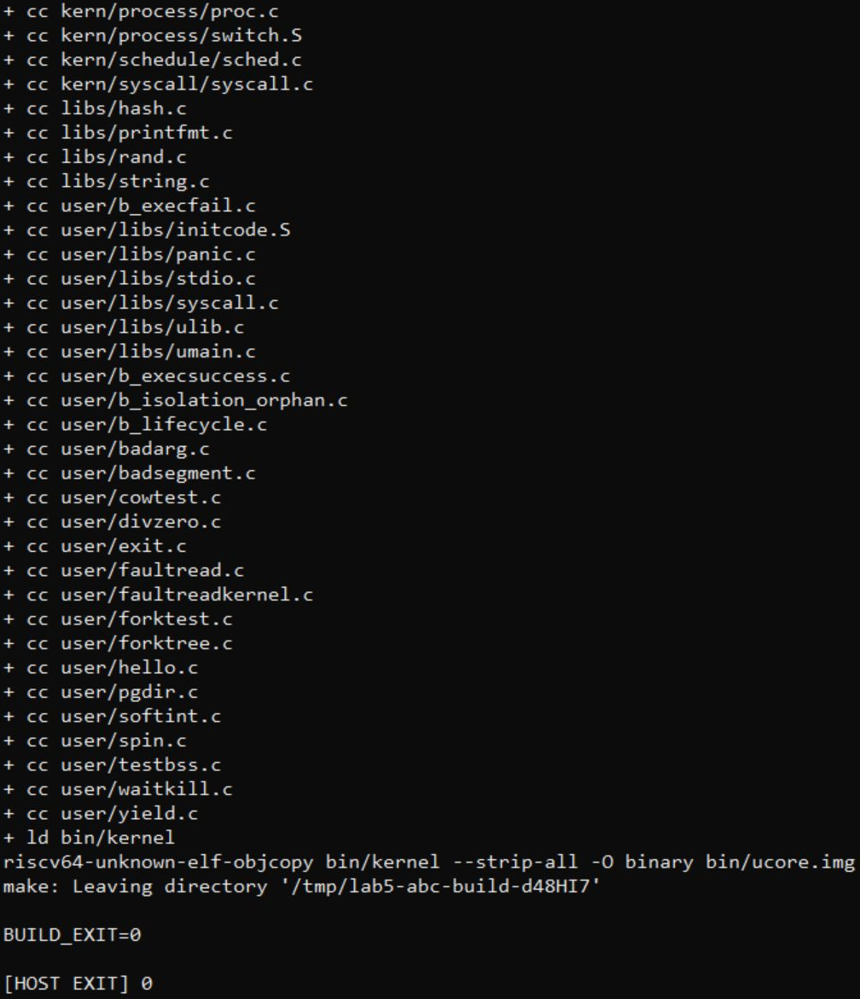
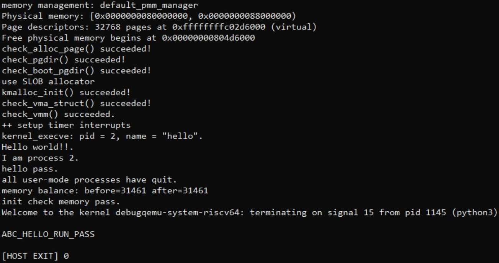
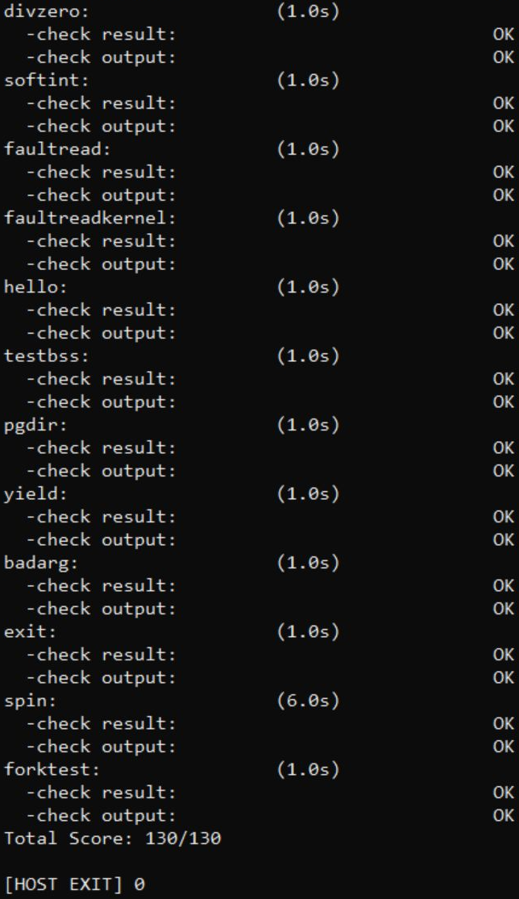
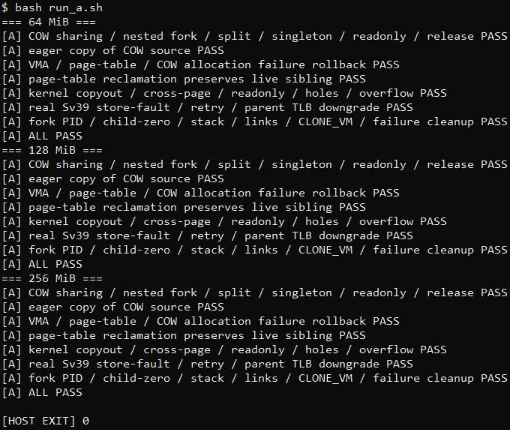
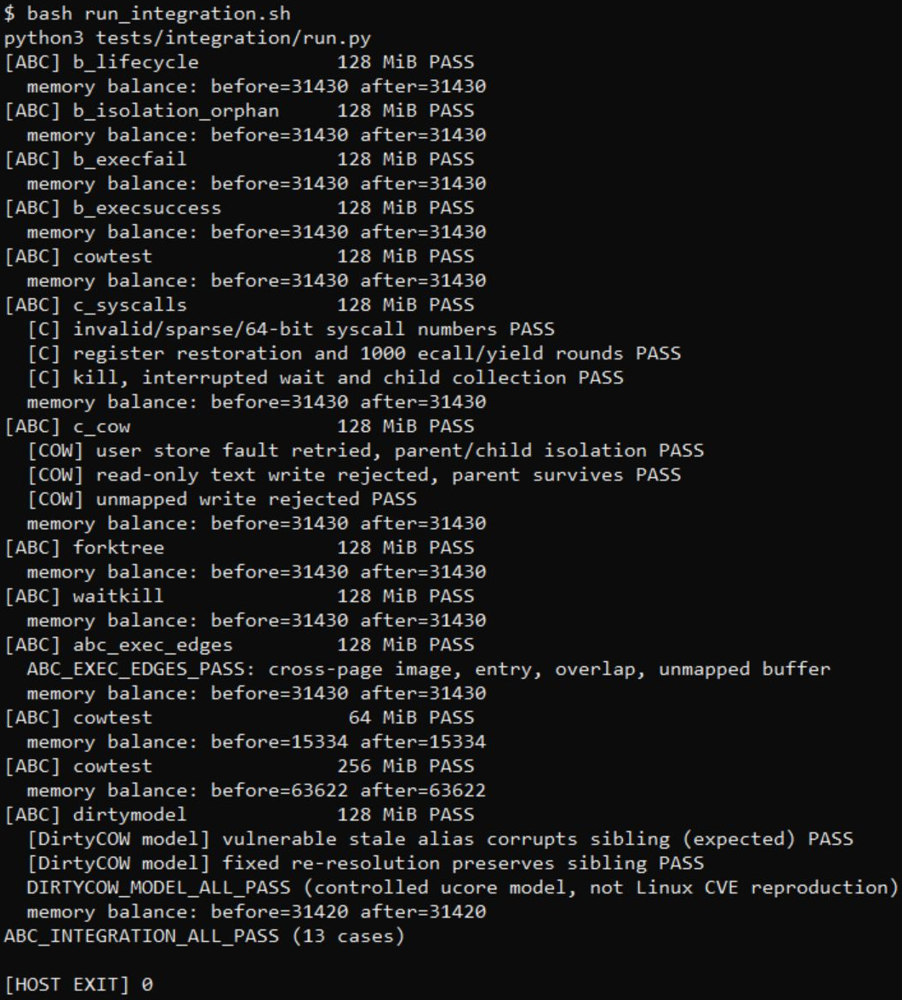
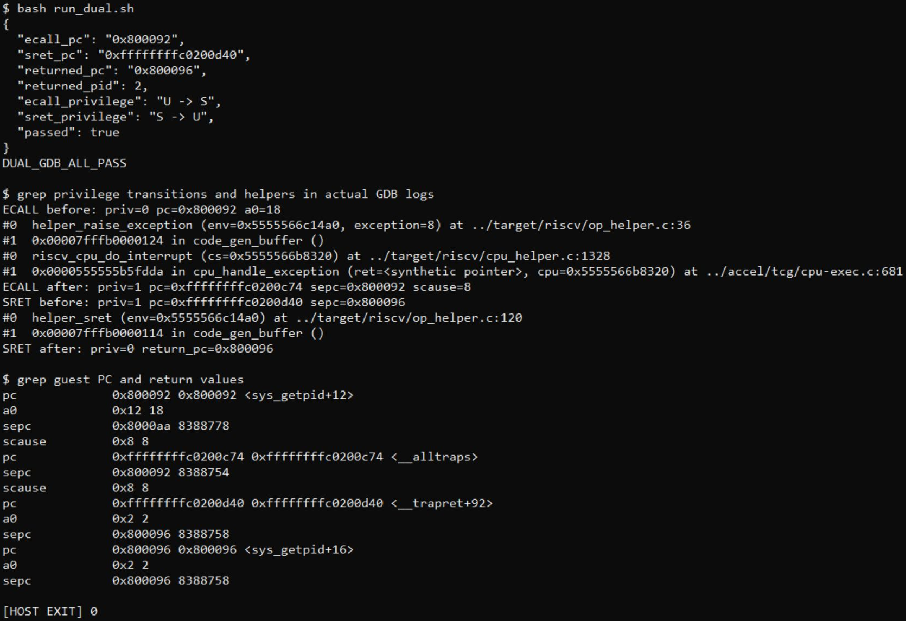

# 操作系统实验报告

## 实验基本信息

| 项目 | 内容 |
|---|---|
| **实验名称** | Lab5：用户进程 |
| **小组成员** | 2413636-杨思远、2413681-王优、2413682-严苑毓 |
| **完成日期** | 2026-11-23 |

### 小组分工

| 成员 | 负责的练习与模块 | 报告分工 |
|---|---|---|
| 2413636-杨思远 | A：物理内存与页表基础、进程复制、COW 核心、引用计数和分配失败回滚 | 进程复制、COW 设计、状态转换与内存专项验证 |
| 2413681-王优 | B：用户程序启动、ELF 装载、exec、wait、exit、父子关系及孤儿回收 | 用户程序装载、进程生命周期、预加载问题与功能测试 |
| 2413682-严苑毓 | C：系统调用、异常进入返回、调度与上下文切换、yield/kill、双 GDB、Dirty COW 类模型；负责 ABC 集成验收 | 系统调用、特权级切换、QEMU/TCG 分析、扩展分析及报告统稿 |

---

## 一、实验目的

1. 建立用户进程的运行环境，理解从内核线程启动到用户程序执行的完整过程。
2. 实现用户态系统调用框架，掌握 `ecall` 进入内核、参数分发及 `sret` 返回用户态的机制。
3. 实现 `fork/exec/wait/exit/yield/kill`，贯通进程创建、执行、调度、等待和回收。
4. 实现写时复制 COW，掌握页面共享、写入分离、引用计数、异常重试和失败回滚。
5. 通过双 GDB 观察 QEMU 对 `ecall/sret` 的执行，理解 TCG、虚拟 CPU 状态和异常模拟。
6. 结合实际测试理解页表权限与内核写入的一致性，用受控交错模型分析 Dirty COW 类问题及修复方法。

## 二、实验环境

| 项目 | 配置 |
|---|---|
| 宿主及实验系统 | Windows、WSL Ubuntu-22.04 |
| 指令集与分页 | RISC-V 64 位、Sv39、4 KiB 基础页 |
| 执行平台 | 单核 QEMU，分别使用 64、128、256 MiB 内存 |
| 编译工具 | `riscv64-unknown-elf-gcc`、GNU Make、交叉链接与反汇编工具 |
| 模拟器与固件 | QEMU 7.0.0、OpenSBI |
| 调试工具 | RISC-V 交叉 GDB、本机 x86-64 GDB |
| 测试驱动 | Python 3、QEMU 实际执行、分配故障注入、寄存器探针 |

| 成员 | AI 编程工具 | 底层模型 | 主要用途 |
|---|---|---|---|
| 杨思远 | ChatGPT | GPT-6.1-sol | 地址空间复制、COW 规格和专项测试 |
| 王优 | ChatGPT | GPT-6.1-sol | 装载与生命周期设计、功能测试 |
| 严苑毓 | ChatGPT | GPT-6.1-sol | 系统调用、异常切换、整合验证及报告整理 |

构建以课程 Lab5 框架为基础，继承小组 Lab4 的内存、页表和线程基础。启动适配器把课程的固定地址 loader 参数转换为 OpenSBI 的 `-kernel` 装载方式，使普通运行、调试和评分使用相同入口。课程评分脚本按原有检查条件运行。用户测试程序采用 `-O0`，使除零教学样例生成实际除法指令；内核使用优化构建。

## 三、实验整体逻辑分析

### 2.1 本章节的逻辑主线

Lab4 的线程在内核态执行，Lab5 则让普通程序运行在权限受限的用户态。用户进程需要独立的地址空间、用户栈和执行入口；当它请求输出、创建子进程或退出时，再通过系统调用进入内核。

整章形成以下闭环：**建立进程及地址空间 → 装载用户程序 → 恢复现场进入 U 态 → ecall 请求服务 → 内核执行进程管理 → 调度与异常返回 → 用户程序继续执行或退出回收。**

进程控制块 `proc_struct` 组织状态、编号、内核栈、地址空间和亲缘关系；`mm_struct` 管理一个地址空间，`vma_struct` 描述其中合法的虚拟区间；页表把这些虚拟区间落实到物理页面。trapframe 保存异常前的程序现场，context 保存内核调度的续执行位置。两类现场协同完成首次启动和后续切换。

### 2.2 功能的逐步实现

1. **恢复物理内存和页表基础。**物理页分配、引用计数和 Sv39 映射为用户地址空间提供资源。
2. **建立系统调用入口。**用户库统一寄存器约定，异常入口把请求交给内核服务。
3. **创建并装载第一个用户程序。**构造 ELF 映像、用户栈和 trapframe，通过异常返回进入用户态。
4. **完成进程复制及生命周期。**fork 建立子进程，exec 替换映像，wait 与 exit 完成等待、通知和回收，yield/kill 与调度器协同工作。
5. **引入 COW。**fork 时共享只读页面，把实际页面复制延迟到首次写入；进程退出和程序替换按引用关系释放资源。
6. **进行底层观察和整体验证。**通过故障注入、用户程序、双 GDB 和状态失效模型检验功能及边界行为。

## 四、实验内容与实现

### 功能模块一：用户态系统调用

**负责人：2413682-严苑毓。**

#### 模块功能描述

```c
void exception_handler(struct trapframe *tf);
void syscall(void);
static int sys_exit(uint64_t arg[]);
static int sys_fork(uint64_t arg[]);
static int sys_wait(uint64_t arg[]);
static int sys_exec(uint64_t arg[]);
static int sys_yield(uint64_t arg[]);
static int sys_kill(uint64_t arg[]);
static int sys_getpid(uint64_t arg[]);
static int sys_putc(uint64_t arg[]);
static int sys_pgdir(uint64_t arg[]);
```

用户库将系统调用号放入 `a0`，五个参数依次放入 `a1～a5`，执行 `ecall` 后由内核接管。CPU 保存异常地址和原因，并跳到异常入口；入口汇编保存通用寄存器和控制状态，C 层把当前 trapframe 关联到 `current->tf`。

`exception_handler` 识别 `CAUSE_USER_ECALL` 后先执行 `epc += 4`，再调用 `syscall`。推进放在分发前，是因为成功的 exec 会直接重建现场并设置新程序入口；随后应按新入口返回。

`syscall` 读取完整 64 位调用号，依次检查数组范围和稀疏槽位。合法编号转交相应封装，非法编号返回 `-E_INVAL`。保存完整位宽使带高位的伪造编号也得到正确处理。各 `sys_*` 将参数转换为对应类型，再调用 `do_fork/do_execve/do_wait/do_exit` 等服务，返回结果以符号扩展形式写回 `a0`。

用户库采用固定数量的参数和显式寄存器约束，返回操作数使用机器字宽。这样编译器能跟踪输入、输出和内存副作用，RV64 的结果写入与 C 对象宽度也保持一致。

#### 最终提示词

```text
[PROMPT] 完成用户态系统调用入口、分发和九个 sys_* 封装。
[RELY] RV64；current->tf 保存现场；a0 为编号，a1-a5 为参数，结果写回 a0。
[SPECIFICATION] ecall 分发前推进 epc 4 字节；使用完整 64 位编号检查范围和空槽；
合法调用转交 do_*，非法调用返回 -E_INVAL；用户库通过寄存器约束表达输入输出。
[VALIDATION] 检查正常调用、零号、空槽、高位编号、返回值及连续调用后的寄存器恢复。
```

#### 实现迭代过程

代码审查发现原用户封装以 64 位 `sd` 写入四字节 int，并无条件读取五个变参。修正为固定参数和机器字宽寄存器操作数后，返回值与寄存器约定统一。专项测试覆盖零号、未实现编号、全 1 编号和带高 32 位的 getpid 伪造编号，均得到规定错误；汇编探针和连续 1000 轮 getpid/yield 验证了寄存器恢复和重复调用。

### 功能模块二：创建并加载第一个用户进程

**负责人：2413681-王优。**

#### 模块功能描述

```c
static struct proc_struct *alloc_proc(void);
void proc_init(void);
int kernel_thread(int (*fn)(void *), void *arg, uint32_t clone_flags);
static int init_main(void *arg);
static int user_main(void *arg);
static int kernel_execve(const char *name, unsigned char *binary, size_t size);
int do_execve(const char *name, size_t len, unsigned char *binary, size_t size);
static int load_icode(unsigned char *binary, size_t size);
int do_wait(int pid, int *code_store);
```

`alloc_proc` 对 PCB 完整清零，将新进程设为未初始化状态，并准备链表节点。`proc_init` 建立 idle 和 init：idle 使用启动栈作为调度回退目标，init 负责启动用户程序并回收后续退出的进程。

启动链为 `proc_init → kernel_thread(init_main) → kernel_thread(user_main) → kernel_execve → do_execve → load_icode → forkrets → sret`。`user_main` 选择链接进内核的用户 ELF；`load_icode` 建立全新的 mm 和根页表，按 ELF program header 装入代码、数据及 BSS，映射用户栈，然后设置用户入口、栈顶和 SPP/SPIE。`kernel_execve` 在关闭当前中断后，将准备好的现场交给异常返回链。用户初始状态设置为 SPP=0、SPIE=1、SIE=0，使寄存器恢复期间保持中断关闭，并由 sret 正式进入 U 态、恢复中断允许状态。

ELF 装载依次检查文件头大小、program header 表范围、文件段与内存段长度、用户地址范围和入口位置。每个装载段先分配并清零页面，再复制该页对应的文件内容，因此文件数据以外的 BSS 保持零。入口必须落在可执行段中；重叠区间由映射接口返回错误。装载失败时按下级映射、页表、VMA、mm 的顺序释放已分配资源。

`do_execve` 先将名称和用户提供的 ELF 拷入内核缓冲区，再切回内核页表、释放旧地址空间并装入新映像。内核复制按源 mm 的叶子 PTE 逐页检查和读取，因此跨页镜像和地址空间中的空洞都能得到明确处理。堆的大块分配采用向上取整的页阶，保证镜像缓冲区覆盖请求长度。

`do_wait` 扫描当前进程的子链表：发现僵尸时取得退出码并回收；存在尚未退出的目标时，原子设置睡眠状态和 WT_CHILD 后调度；目标不存在时返回 `-E_BAD_PROC`。退出码通过 COW 感知的 `copy_to_user` 写回。复制在恢复中断后执行，随后进入短临界区摘除僵尸节点，使可能获取 mm 锁的操作和进程树更新各自具有清晰边界。

#### 最终提示词

```text
[PROMPT] 实现首个用户程序启动、ELF 加载、exec、wait 和进程关系维护。
[RELY] Lab5 proc/mm/VMA/trapframe 与 ELF 结构；已有 fork、页分配和异常返回接口。
[SPECIFICATION] 完整初始化 PCB；校验 ELF 和入口；复制段、清零 BSS、建立用户栈；
exec 先保存旧地址空间中的输入，再发布新映像；wait 匹配 PID、返回退出码并回收僵尸。
[VALIDATION] 测试正常启动、exec 成功/失败、跨页镜像、非法入口、重叠段及空洞缓冲区。
```

#### 实现迭代过程

启动映射和运行时映射分别采用恒等过渡及完整三级页表，使早期地址切换与后续用户映射衔接。exec 的输入复制增加叶子映射检查；堆分配向上取整，映射接口增加区间相交检查。对应测试中，8193 字节跨页 ELF 成功替换进程并返回退出码 73；非法入口和重叠段使对应子进程按错误路径结束；空洞缓冲区返回参数错误，父进程持续正常运行。

### 功能模块三：复制用户进程

**负责人：2413636-杨思远。**

#### 模块功能描述

```c
int do_fork(uint32_t clone_flags, uintptr_t stack, struct trapframe *tf);
static int copy_mm(uint32_t clone_flags, struct proc_struct *proc);
static void copy_thread(struct proc_struct *proc, uintptr_t stack, struct trapframe *tf);
int dup_mmap(struct mm_struct *to, struct mm_struct *from);
int copy_range_prepare(pde_t *to, pde_t *from, uintptr_t start, uintptr_t end);
int copy_range(pde_t *to, pde_t *from, uintptr_t start, uintptr_t end, bool share);
```

`do_fork` 按 PCB、内核栈、地址空间、trapframe/context 的顺序准备资源，成功后在中断保护下分配 PID、接入散列表和进程树，再设为可运行。发布前复查进程容量；失败时反向释放已经取得的资源。

`copy_thread` 将父现场复制到子进程内核栈，令子 `a0=0`，设置用户栈及首次执行的 forkret 入口。父进程的系统调用返回值由 syscall 写为子 PID，于是一次 fork 在父、子分别表现为正 PID 和 0。

`copy_mm` 区分三种场景：内核线程复用内核地址空间；CLONE_VM 增加 mm_count 并共享整个 mm；普通 fork 创建独立 mm、VMA 和页表，再使用 COW 共享物理数据页。mm_count 统计共享地址空间的进程数，Page.ref 统计页面映射等引用，两者管理不同层次的所有权。

`dup_mmap` 采用三阶段事务：先复制全部 VMA，再为目标预分配全部所需页表，最后提交 COW 映射和父页降权。前两阶段失败时，目标临时资源被释放，父页权限和引用数保持原值；提交阶段使用已准备的页表，更新映射时完成引用计数及 TLB 失效。

`copy_range` 同时提供立即深复制路径。COW 路径用于普通 fork，深复制路径用于验证实际页面内容和独立副本语义。`get_pte` 对三级页表逐级查找，在末级分配失败时撤销本次新建的中间表；`exit_range` 扫描完整下级表，确认全空后逐级释放，从而保留仍服务于其他 VMA 的兄弟映射。

#### 最终提示词

```text
[PROMPT] 实现 do_fork、copy_mm、copy_thread、dup_mmap 和 copy_range。
[RELY] Sv39、单核、Best-Fit、Page.ref、mm_count、进程树及已有映射接口。
[SPECIFICATION] 父返回子 PID、子返回 0；普通 fork 独立 mm/页表，CLONE_VM 共享 mm；
复制 VMA、预分配页表、提交 COW 分阶段进行；失败逆序回收；新进程准备完成后原子发布。
[VALIDATION] 检查上下文、进程关系、深复制、共享语义，以及 PCB/栈/mm/VMA/页表 OOM 回滚。
```

#### 实现迭代过程

页表释放增加了整表空闲检查，分配接口增加了新建中间表的失败回滚。专项测试通过包装真实 PMM 分配器和 kmalloc 注入不同阶段的分配失败，逐项比较父 PTE、引用数、子链表和空闲页数。整合后的用户态 forktree 进一步生成深度 4 的完整二叉进程树，31 个用户节点执行结束后由等待与孤儿托管机制回收，空闲页数恢复。

### 功能模块四：退出、让出 CPU 与终止进程

**负责人：王优负责 do_exit，严苑毓负责 do_yield/do_kill 及调度。**

#### 模块功能描述

```c
int do_exit(int error_code);
int do_yield(void);
int do_kill(int pid);
void cpu_idle(void);
void proc_run(struct proc_struct *proc);
void schedule(void);
void switch_to(struct context *from, struct context *to);
```

`do_exit` 切回内核页表，减少当前 mm 的进程引用；最后一个共享者负责解除映射、释放根页表和 mm。随后记录退出码、进入僵尸态、唤醒等待的父进程，并将子进程交由 init 托管。PCB 和内核栈由父进程 wait 回收，保证正在执行退出路径的内核栈具有完整生命周期。

`do_yield` 设置 need_resched，trap 的返回路径统一进入调度。`do_kill` 校验 PID 和状态，设置 PF_EXITING，并唤醒可中断睡眠者；目标进程在规定的返回检查点执行退出。idle 和 init 作为系统管理进程受到保护。

`schedule` 从当前节点的后继查找可运行者，空集回退 idle；`proc_run` 使 current、satp 和寄存器现场同步切换。satp 使用 Sv39 MODE 和根页表物理页号，页表切换后刷新 TLB。`switch_to` 按 context 布局保存恢复 ra、sp、s0～s11。唤醒同时清除等待原因，使多个子进程依次退出时父进程的等待状态保持一致。

#### 最终提示词

```text
[PROMPT] 实现 exit/yield/kill，并贯通等待、唤醒和调度。
[SPECIFICATION] exit 按 mm_count 释放地址空间，僵尸交由 wait 回收，孤儿转交 init；
yield 请求重调度；kill 设置退出意图并唤醒可中断睡眠；切换期间维护 current/satp/context 一致。
[VALIDATION] 检查退出码、重复 wait、父先退出、等待中 kill、忙循环被调度和最终内存平衡。
```

#### 实现迭代过程

并发退出测试促使唤醒操作同步更新 wait_state。内存平衡检查还覆盖 SLOB 堆：回收完成时将整页空闲块归还 PMM，随后执行严格的前后计数比较。`b_lifecycle`、`b_isolation_orphan`、`exit`、`spin` 和 `waitkill` 分别验证退出码、孤儿托管、等待回收、终止忙循环和等待过程中的退出请求。

### 练习：异常现场、双栈与特权级切换

**负责人：2413682-严苑毓。**

内核执行时 sscratch 为 0；用户执行时 sscratch 保存当前进程的内核栈顶。`SAVE_ALL` 交换 sp 与 sscratch，识别异常来源并选取可信内核栈；保存全部现场后，将 sscratch 设为 0，为内核内的后续异常保留相同协议。

`RESTORE_ALL` 根据保存的 SPP 判断返回目标：返回 U 态时把当前帧末端写入 sscratch，返回 S 态时令其为 0。然后恢复 sstatus、sepc 和通用寄存器，最后恢复 sp。`sret` 依据 SPP 返回目标特权级，并按 SPIE 恢复中断状态。这个过程同时服务于首次进入用户程序和系统调用返回。

trapframe 保存异常打断的完整现场，context 保存调度时的内核续执行现场。用户异常返回恢复调用前的程序状态，内核调度恢复先前的函数执行位置；二者分别承担异常恢复与进程切换。

### 练习：双 GDB 跟踪系统调用与 TCG

**负责人：2413682-严苑毓。**

本机 GDB 把 QEMU 作为调试子进程，交叉 GDB 连接 QEMU 的 guest 调试口。guest 加载内核及用户 ELF 符号，并从反汇编自动定位 getpid 的 ecall 和内核 sret。先让 guest 停在目标指令前，再在 host 设置 helper 断点，观察虚拟 CPU 状态的变化。

| 观察位置 | 实际结果 | 说明 |
|---|---|---|
| 用户 getpid 的 ecall 前 | PC=`0x800092`，a0=18 | 用户态通过寄存器提出服务请求 |
| `helper_raise_exception` | exception=8，priv=0 | QEMU 为 U 态 ecall 产生异常 |
| `riscv_cpu_do_interrupt` 完成 | priv=1，sepc=`0x800092`，scause=8 | 虚拟 CPU 进入 S 态并保存异常地址 |
| 内核 sret 前 | PC=`0xffffffffc0200d40`，sepc=`0x800096`，a0=2 | 内核已完成 getpid 并恢复返回现场 |
| `helper_sret` 完成 | priv=0 | 虚拟 CPU 恢复 U 态 |
| guest 单步返回 | PC=`0x800096`，a0=2 | 从 ecall 后一条指令继续执行，返回当前 PID |

这些地址由测试构建自动提取，测试同时断言返回 PC=ecall+4、返回 PID=2。两个调试器具有不同暂停层次：guest 单步等待目标指令完成时，host 可能正在 helper 中暂停；继续 host 后，guest 才能收到单步完成结果。

QEMU 7.0 的 `trans_ecall` 生成异常操作，`trans_sret` 生成对 helper_sret 的调用并结束当前翻译块。实际 host 调用栈出现 `code_gen_buffer → cpu_tb_exec → cpu_exec`，表明 guest 指令先经 TCG 转成宿主可执行代码，再调用相应运行时 helper。异常循环更新 sepc、scause、权限和目标 PC，返回 helper 恢复权限与执行位置。

此前的双 GDB 地址翻译实验也发生在 TCG 执行路径中：翻译后的访存代码使用软件 TLB，未命中时进入软件 MMU 慢路径。TCG 解决指令执行，MMU 解决访存地址映射，二者在模拟 CPU 执行过程中协同。特权级和页表变化还会影响翻译块状态及地址缓存的有效性。

### 练习：用户程序的预加载时机

**负责人：2413681-王优。**

用户源程序先经交叉编译和用户链接脚本生成 ELF，再作为二进制数据链接进内核镜像。QEMU 启动装入内核时，这些 ELF 数据随内核一起进入物理内存。此时它们是供装载器读取的程序映像；到 `user_main` 选择程序并执行 `load_icode` 后，才建立用户地址空间，把相应段装入用户页面并开始执行。

常用操作系统通常从文件系统查找可执行文件，建立文件映射，并结合按需分页读取程序页面。本实验采用链接内嵌映像和显式段复制，把程序来源与文件系统解耦，使进程构造、地址空间替换和特权级切换的关系更加直接。用户态 exec 测试进一步从用户缓冲区提供 ELF，验证了程序替换接口与镜像保存过程。

### Challenge：Copy on Write 机制

**负责人：杨思远负责核心，王优负责生命周期，严苑毓负责异常接入和整体验证。**

fork 为父子分别建立页表，数据页先共享。原可写页面使用 Sv39 软件保留位 `PTE_COW=0x100` 标记，双方清除 W。真正只读的代码页保持只读共享，写入权限仍由 VMA 和叶子 PTE 共同决定。

| 当前状态 | 事件 | 状态转换与资源变化 |
|---|---|---|
| 私有可写，W=1、ref=1 | fork | 父子共享同一物理页；W=0、COW=1，ref 增加 |
| 已共享 COW 页 | 再次 fork | 新增只读映射，保留 COW，ref 增加 |
| COW 页，ref>1 | 合法写缺页 | 分配新页并复制整页；写者转为 W=1、COW=0；旧页 ref 减少 |
| COW 页，ref=1 | 合法写缺页 | 原映射恢复 W、清除 COW，物理页保持 |
| 真正只读页 | 写入 | 权限检查返回非法访问，目标用户进程进入退出路径 |
| COW 页 | 数据页分配失败 | 返回 `-E_NO_MEM`，原映射、数据和引用数保持 |
| 任意映射 | exit/exec/解除映射 | ref 减少；最后一个引用释放物理页 |

`cow_pgfault` 在 mm 锁内校验可写 VMA、用户叶子 PTE、COW 标记与栈保护页，执行页面复制或原地改权，并刷新 TLB。C 的异常处理仅在 store page fault 尝试该接口。成功后保持 epc，CPU 返回原写指令重试；系统调用则推进 epc，这两类异常分别对应重试和继续。

内核写用户内存同样遵循 COW。`copy_to_user` 先检查目标区间，逐页取得叶子 PTE，必要时拆分共享页，再通过新页面的内核直映地址写入。该方法支持跨页复制，也使 wait 返回退出码时正确维护父子页面隔离。

最终验收覆盖父子双方写入、孙进程再次 fork、跨页数据隔离、子孙退出后的单引用恢复、exec 释放共享映射、只读写入处理和内存不足回滚。A 的实际 store 测试还先建立可写 TLB，再执行 fork 降权，验证真实写缺页及重试过程。

### Challenge：Dirty COW 类状态一致性分析

**负责人：2413682-严苑毓。**

Dirty COW 提示了一个关键问题：用户页表权限与内核已经取得的写引用必须指向同一版本的映射。即使某个用户 PTE 已被设为只读，内核仍可能持有旧物理页的可写直映地址；映射发生 COW 分离后，继续使用该地址会把写入送到旧共享页。

实验使用 ucore 的真实页面和两套页表构造确定性交错模型：

1. 父子映射共享初值为 7 的 COW 页面，T1 保留旧页面的内核可写别名并增加引用。
2. T2 为父映射完成 COW 分离，父映射指向新页面。
3. 状态失效路径继续经旧别名写 99，观察到父新页仍为 7，另一共享映射变为 99。
4. 修复路径在 COW 完成后重新解析写者当前映射，再写新页，观察到父为 99、另一映射保持 7。
5. 释放 pin、映射、页表和 mm，核对空闲页数恢复。

该模型把竞争窗口转化为可重复的逻辑交错，用页面身份和数据断言验证失效与修复。生产写入路径采用“锁定 mm、检查权限、拆分 COW、重新取得当前叶子映射、写入新页”的顺序。Linux 的原始案例还涉及文件页缓存、私有映射和页获取接口；本实验模型突出其中的旧写引用与映射身份问题。

## 五、测试与验证

### 5.1 验证方法

验证按构建、模块、用户态集成和底层观察四层组织。模块测试执行真实 PMM/VMM 和 fork 实现，通过分配预算注入失败，检查前后 PTE、引用数、页面内容和空闲页；用户程序经完整系统调用与 sret 路径运行；双 GDB 同时观察 guest 和 QEMU。

每个用户集成用例同时检查功能标志、异常情况及最终 `init check memory pass.`。回收检查先将 SLOB 中整页空闲块归还 PMM，再比较启动前后空闲页数，使页面回收结果具有一致计量口径。测试驱动在取得完整结果后结束 QEMU，日志保留实际输出。

| 测试项目 | 方法与关键检查 | 结果 |
|---|---|---|
| 干净构建 | 完整源码重新编译、链接并生成内核镜像 | 退出码 0 |
| 课程评分 | 13 个课程用户程序及进程创建、系统调用、进程控制注入检查 | **130/130** |
| A 模块专项 | 64/128/256 MiB；COW、深复制、OOM、活兄弟表、copyout、真实 store 缺页、fork/CLONE_VM | 三组全部通过 |
| B 生命周期 | 退出码、重复 wait、父先退出、孤儿托管 | 通过 |
| B 程序替换 | 有效 ELF、失败退出、用户缓冲区中的 ELF | 通过 |
| C 系统调用 | 非法/空槽/高位调用号、寄存器探针、1000 轮 getpid/yield、kill | 通过 |
| 多代 COW | 父子与孙进程写入隔离、退出码、单引用恢复；64/128/256 MiB | 通过 |
| 进程树和等待中终止 | forktree 的 31 个用户节点；waitkill 的父子终止及托管回收 | 通过 |
| exec 边界 | 8193 字节镜像、可执行入口、重叠段、空洞缓冲区 | 通过 |
| COW 访问边界 | 合法写入重试、只读文本写入、未映射写入 | 通过 |
| Dirty COW 类模型 | 旧别名污染、重新解析修复、资源归还 | 通过 |
| 双 GDB | U→S→U、scause=8、返回 PC=ecall+4、a0=2 | 通过 |

独立用户态集成套件共 **13 项**，全部得到功能结果及内存平衡通过标志。128 MiB 多代 COW 用例的空闲页计数为 `31430 → 31430`；64 MiB 为 `15334 → 15334`；256 MiB 为 `63622 → 63622`。31 节点进程树和 exec 边界测试结束后也恢复相应初始计数。

### 5.2 编译和运行截图



图中完成用户程序和内核的编译、链接及镜像生成，最终构建退出码为 0。



图中用户程序通过系统调用输出内容和 PID，随后退出，父进程完成回收并通过内存平衡检查。

### 5.3 课程完整评分



课程用例覆盖错误段访问、除零教学行为、读错误、内核地址访问、hello、BSS、页表查看、yield、非法参数、退出、终止忙循环及 fork 压力。最终总分为 130/130。

### 5.4 模块及集成验证





模块与集成结果相互补充：模块故障注入检查分配失败时的资源状态，用户集成检查真实用户指令经过异常、系统调用和调度后的整体行为。

### 5.5 双 GDB 证据



图中 host helper 的权限变化与 guest 的 PC、sepc、a0 相互对应，验证系统调用的进入、处理和返回。

## 六、实验总结与收获

### 对操作系统的理解

| 实验知识点 | OS 原理知识点 | 含义、联系及差异 |
|---|---|---|
| PCB、进程树和 PID | 进程抽象与亲缘关系 | 执行实体由状态、资源和现场组成；父子及兄弟链表把抽象关系落实为可维护结构 |
| trapframe/context | 异常恢复与上下文切换 | 前者恢复被打断程序的完整现场，后者恢复内核调度的续执行位置 |
| ecall/sret 和双栈 | 系统调用与保护边界 | 硬件切换权限，软件保存现场并选择可信内核栈，形成受控服务通道 |
| mm/VMA/页表 | 虚拟内存与地址空间 | VMA 表达合法区间，页表表达实际映射；内存复制同时校验两个层次 |
| fork/exec | 进程创建与映像替换 | fork 建立新执行实体，exec 在当前实体中替换程序；两者组合支持独立启动程序 |
| wait/exit 与托管 | 阻塞、唤醒和资源生命周期 | 僵尸保留退出信息，父进程负责最终回收，init 承接孤儿管理 |
| COW 与引用计数 | 延迟复制和共享资源 | 独立地址空间通过只读映射共享数据，首次写入再产生私有副本 |
| OOM 事务回滚 | 资源所有权与失败原子性 | 准备与发布分离，失败按所有权逆序清理，使父进程状态保持一致 |
| Dirty COW 类模型 | TOCTOU 和对象身份 | 权限检查、页面复制与实际写入应使用一致映射，旧引用需要重新验证 |
| QEMU/TCG | 硬件抽象与动态翻译 | 虚拟指令转成宿主执行路径，helper 和异常循环维护可观察 CPU 状态 |

进一步的 OS 原理主题包括多核页表同步与 TLB shootdown、文件页缓存和映射、按需分页与交换、信号和线程组、浮点与向量状态管理。它们分别将本实验的单核映射、显式装载、简化退出标志和整数上下文扩展为通用系统机制。

### AI 协作开发的经验

首先通过 spec 明确接口、前后条件、错误码和所有权，再让 AI 生成代码，能使跨模块实现保持一致。本次特别重要的约定是：ecall 推进 epc、COW 写缺页保持 epc，mm_count 与 Page.ref 分别管理地址空间和页面，wait 的用户内存复制与进程树临界区分开处理。

其次，正常样例与反例需要共同设计。hello 检验基本链路，forktree 和 waitkill 检验进程关系及调度，分配故障注入检验回滚，非法 ELF 和空洞缓冲区检验边界，双 GDB 则把寄存器约定与模拟器中的实际状态联系起来。

最后，整合阶段以真实 AB 实现和 C 接口逐函数衔接，再用统一构建和测试确认行为。报告按照实现机制、关键条件、测试方法和可观察结果组织，使代码、解释与实验现象相互对应。
